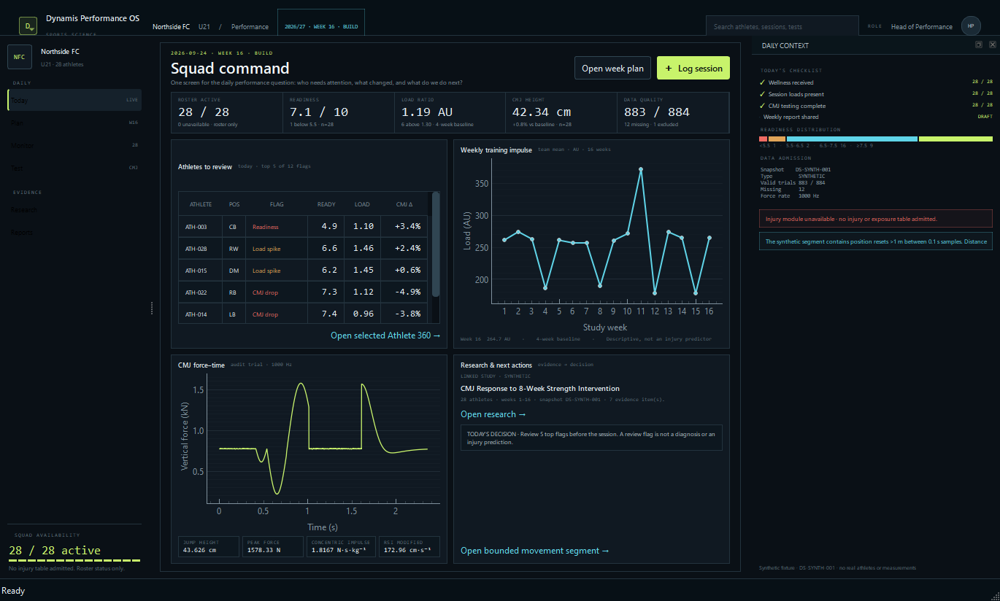

# DynamisScience

**A Windows-first scientific research workstation and Performance OS, built with Python and native Qt Widgets.**


## What it does

DynamisScience brings two local workflows into one desktop application:

- **Research:** project and study authoring, dataset admission and quality control, cohort resolution, frozen analysis plans, qualified runs, diagnostics, evidence, lineage and versioned reports.
- **Performance OS:** Squad Command, Athlete 360, planning, monitoring, performance tests, match/pose inspection, research links and practitioner reports.

The five research workspaces are **Overview & Protocol**, **Dataset & Cohort**, **Exploration & Signals**, **Analysis Plan & Runs**, and **Evidence & Report**. The Performance OS follows **Today → Plan → Monitor → Test → Research → Report**.

The interface uses PySide6/Qt Widgets, pyqtgraph for interactive signals, and Matplotlib for scientific figures and PNG/PDF/SVG exports. Scientific methods and persistent application logic run directly in Python. The desktop application does not require Node.js, a browser runtime, or a local HTTP server.



Additional native evidence: [Research workstation](docs/desktop/evidence/g1-native-synthetic.png), [study authoring](docs/desktop/evidence/g2-study-authoring.png), [Athlete 360](docs/desktop/evidence/g3-performance-athlete.png), and [Match & Pose](docs/desktop/evidence/g3-performance-match.png).

## Run on Windows

Install Python 3.12+ and `uv`, then:

```powershell
uv sync --locked --directory services/science
$env:DYNAMISSCIENCE_DATA_ROOT = 'D:\datasets\DynamisScience'
uv run --directory services/science python -m dynamis_science.desktop
```

The private data root must be an absolute directory outside the repository. On first launch, the application initializes the SQLite WAL research store there or prompts you to choose a root. Admitted research snapshots and user records remain outside Git.

To build the Windows one-directory application and per-user installer:

```powershell
powershell -NoProfile -ExecutionPolicy Bypass -File services/science/scripts/build_windows.ps1
powershell -NoProfile -ExecutionPolicy Bypass -File services/science/scripts/test_windows_installer.ps1
```

The installer includes a deterministic synthetic fixture only. It does not include private Mendeley or MoveSmart records. Installation and uninstall do not remove the configured data root. Qt and Python dependency notices are available under **Help → Open-source licenses** and in [the licensing notice](docs/desktop/THIRD_PARTY_LICENSES.md).

## Scientific integrity and data boundaries

- Mendeley and MoveSmart snapshots retain their checksums, source rights and limitations. MoveSmart is restricted to non-commercial research under its verified source manifest.
- Synthetic `DS-SYNTH-001` data are labeled as demonstration data and are never empirical evidence.
- Unsupported models remain marked as prototypes or unavailable. The app does not produce athlete predictions or injury-risk estimates from unsupported methods.
- Studies, cohorts, plans, runs, evidence, figures, reports and audit history persist in SQLite. Scientific tables and artifacts use Parquet and the configured private filesystem.
- Database integrity checks, verified online backups and isolated restore rehearsals are available from the native **Tools** menu.

The current packaging measurements are recorded in [G4 evidence](docs/desktop/evidence/g4-packaging-benchmarks.json). The migration status and remaining verification are tracked in [RES-604 progress](docs/desktop/RES-604_PROGRESS.md).

## Verify

```powershell
$env:QT_QPA_PLATFORM = 'offscreen'
uv run --directory services/science pytest -q
```

## Licence

**Copyright © 2026 Julio Rodriguez. All rights reserved.** This repository is public for portfolio viewing only. No permission is granted to copy, distribute, modify, deploy or otherwise use any part of it without prior written permission. See [LICENSE](LICENSE) for the full terms.
