<div align="center">

# DynamisScience

**A scientific workbench for sports science — from a research question to reproducible, inspectable evidence, in one continuous workspace.**


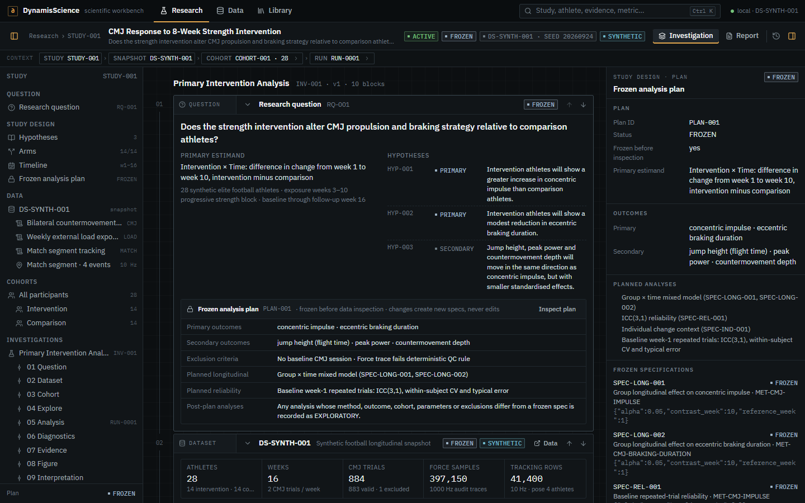

</div>

---

## Why this exists

Sports scientists usually work across disconnected tools: an athlete-management dashboard, a force-plate export, a spreadsheet, a stats script, and a slide deck at the end. At each hand-off the context is lost — which athletes, which trials, which exclusions, which model, which version of the result.

DynamisScience treats the **study** as the unit of work. A scientist opens a study and follows a single investigation:

```text
Question → Data → Cohort → Exploration → Analysis → Diagnostics → Evidence → Interpretation → Report
```

Every number on screen is computed from data, every result carries its uncertainty and diagnostics, and every artifact can be traced back to the measurement it came from. It is designed to feel like a **scientific IDE crossed with a laboratory instrument**, not a KPI dashboard.

> The demonstration study, *CMJ Response to 8-Week Strength Intervention*, runs on a fully **synthetic**, deterministically generated dataset (28 athletes, 16 weeks, 1000 Hz force traces, 10 Hz match tracking and pose). No real athletes or measurements are involved.

## Highlights

- **One persistent study workspace.** Study tree · ordered investigation · contextual inspector, with resizable and collapsible panes and a context strip showing exactly which cohort, run, athlete, trial and event are linked.
- **Typed, serialisable investigation.** The workbench is an ordered document of typed blocks (Question, Dataset, Cohort, Explore, Analysis, Diagnostics, Evidence, Figure, Model, Match Event, Interpretation, Report Section). Blocks reference domain objects by ID and never hold scientific values themselves; the service persists the document with version checks and rejects orderings that break dependencies.
- **Pre-registration that means something.** A frozen analysis plan defines the primary estimand — *difference in change from week 1 to week 10, intervention minus comparison*. Executions that match a frozen spec are `PLANNED`; any change of method, outcome, parameters, cohort or exclusions produces a content-addressed `EXPLORATORY` spec instead of silently rewriting the plan.
- **Immutable runs, explicit evidence.** Runs are append-only and carry software versions, a reproducibility key and a result digest, so a re-execution is recognised as *reproducing* an earlier run. An `EvidenceArtifact` exists only after an explicit, idempotent promotion — and only if diagnostics exist.
- **Diagnostics are part of the chain.** Estimator ladder and fallbacks, residuals by week, normal QQ of standardised residuals, residual spread by arm, sample and missingness context, and stated assumptions — all computed, none decorative.
- **Instruments, not dashboards.** A 1000 Hz force-signal viewer with phase boundaries and a per-metric *Evidence Passport*, and a synchronized 3D field + pose viewer for match events, both opening over the investigation and returning to exactly the same state.
- **Contextual lineage.** Any artifact opens its computed provenance DAG: generator → trials → metric definitions → snapshot → cohort → spec → run → evidence → figure → report.
- **Honest modelling.** A fitted fitness–fatigue model with forward load scenarios, labelled as a mechanistic prototype, which reports its own poor fit rather than hiding it. ML, Bayesian and physics-informed methods are listed as unavailable, never faked.
- **Local and zero-cost.** No API keys, hosted models, cloud services or paid dependencies. Parquet + DuckDB + Polars, FastAPI, Next.js.

## A walk through the study

| | |
|---|---|
| 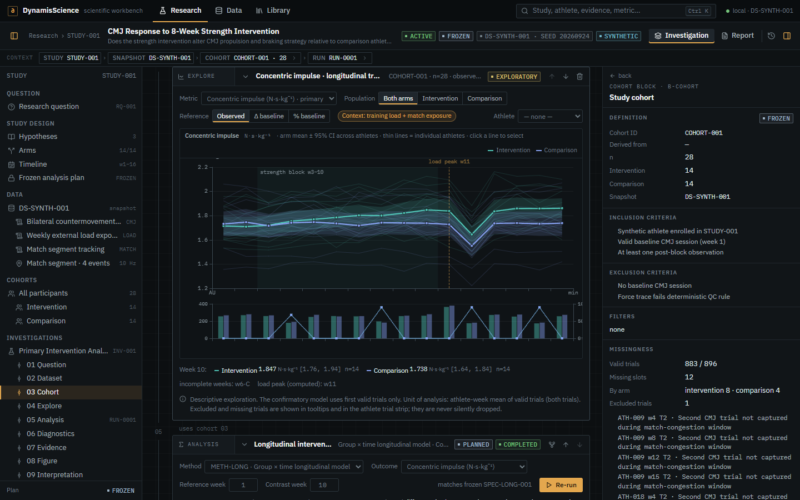 | **Longitudinal exploration.** Arm means with t-based 95% intervals across athletes, every athlete as a trace, the strength block, a *computed* week-11 load peak and a training-load / match-exposure overlay. Missing and excluded trials stay visible. |
| 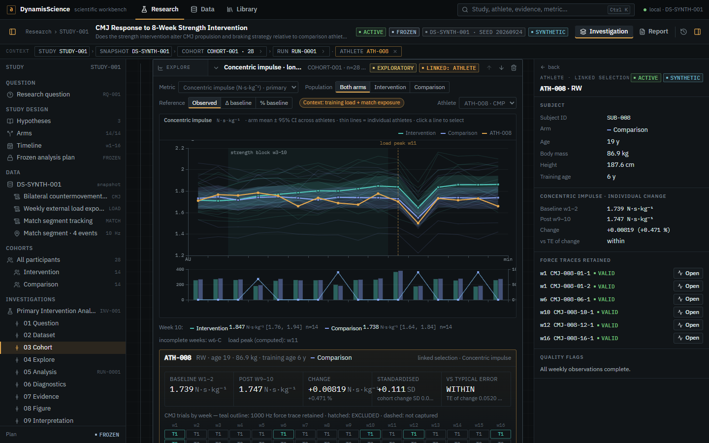 | **Linked athlete selection.** Selecting an athlete highlights them everywhere, shows baseline-to-post change against the typical error of a change, and exposes every trial by week — including which have raw traces and which were excluded, and why. |
| 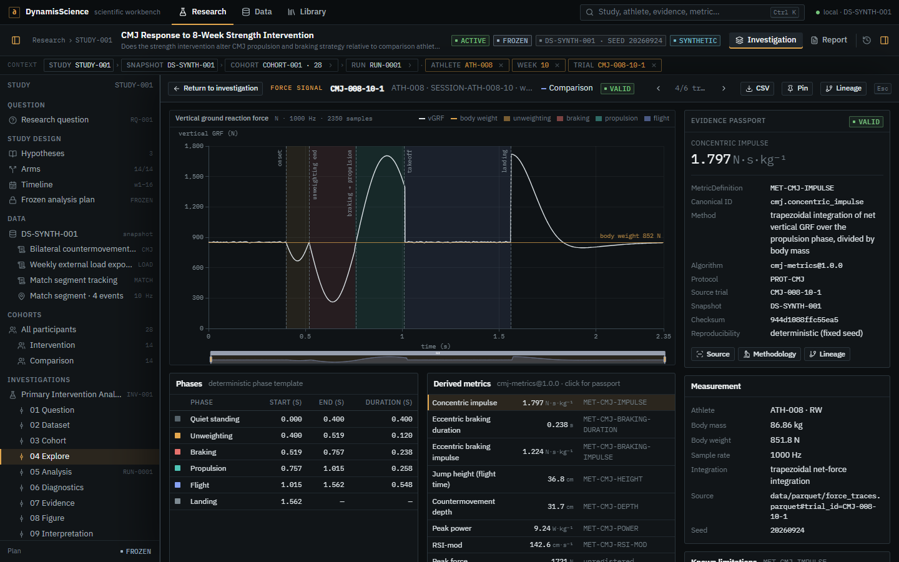 | **Force signal viewer.** The real 1000 Hz vertical GRF on a true time axis with body-weight reference, onset, unweighting, braking, propulsion, takeoff and landing. Each derived metric opens an Evidence Passport resolving to its MetricDefinition, algorithm, protocol, snapshot and checksum. |
| 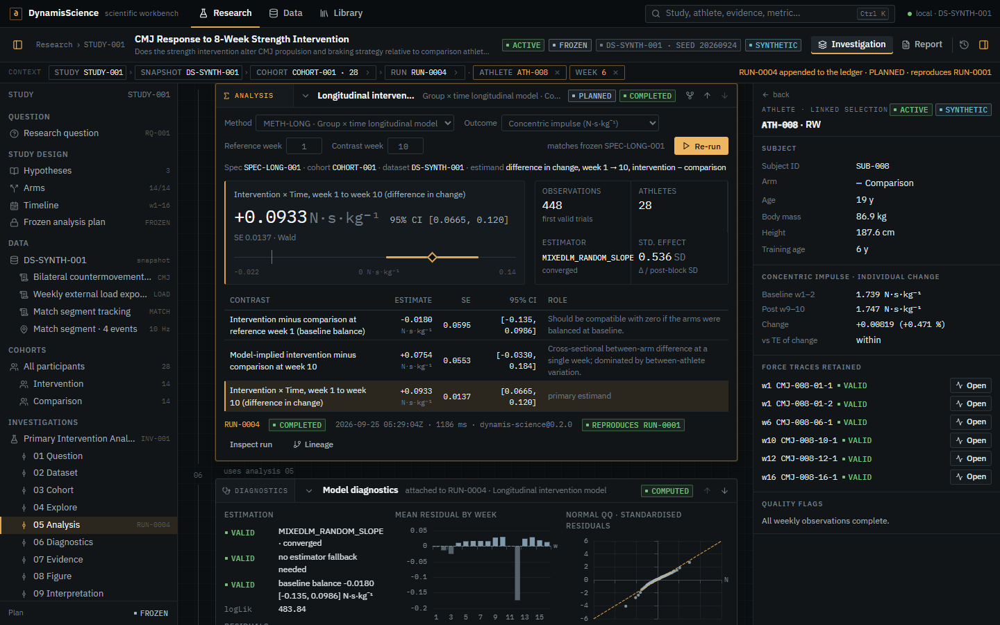 | **Analysis execution.** A MixedLM with athlete random intercept and slope; the primary difference-in-change contrast with SE, Wald 95% CI and an interval plot, secondary contrasts, and a new immutable run recognised as reproducing the seeded one. |
| 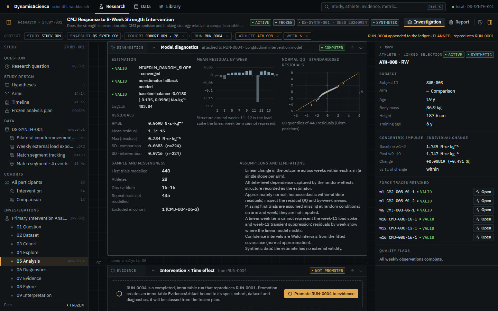 | **Diagnostics attached to the run.** Convergence and fallbacks, baseline balance, residual summary, residuals by week (showing where a linear term misfits the load spike), a normal QQ plot, and explicit assumptions and limitations. |
| 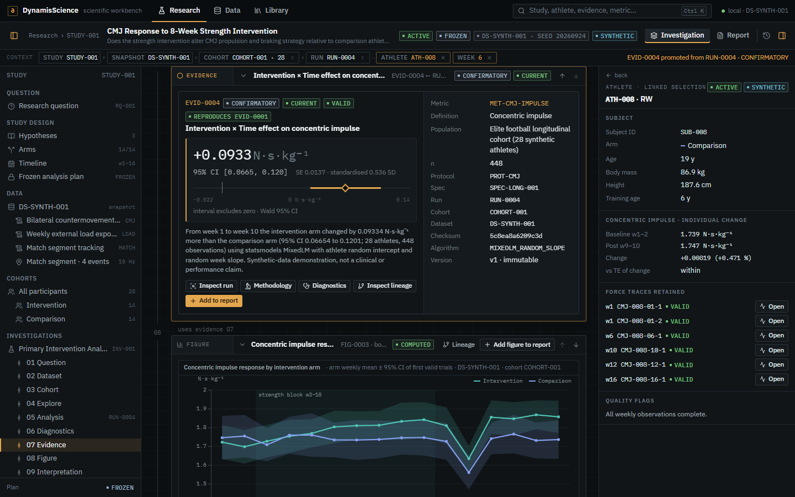 | **Evidence promotion.** The run becomes an immutable, `CONFIRMATORY` EvidenceArtifact bound to its spec, cohort, dataset, checksum and diagnostics, with actions to inspect run, methodology, diagnostics and lineage, or add it to the report. |
| 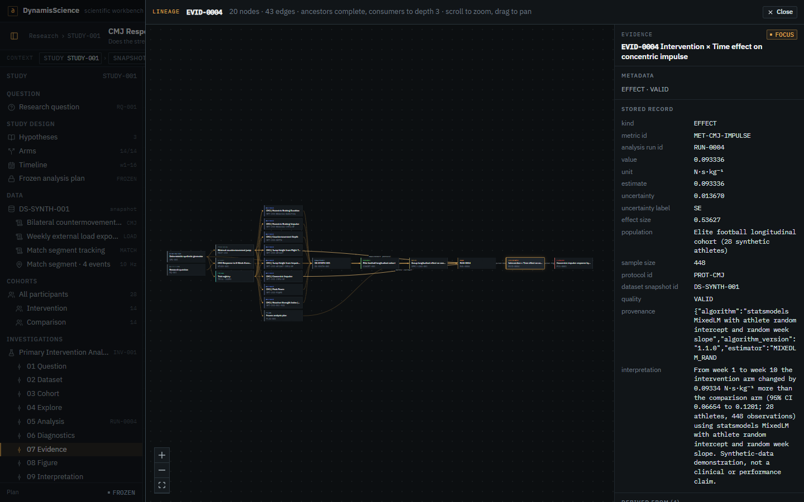 | **Contextual lineage.** A layered provenance DAG computed from stored artifacts; selecting any node shows its stored record. |
| 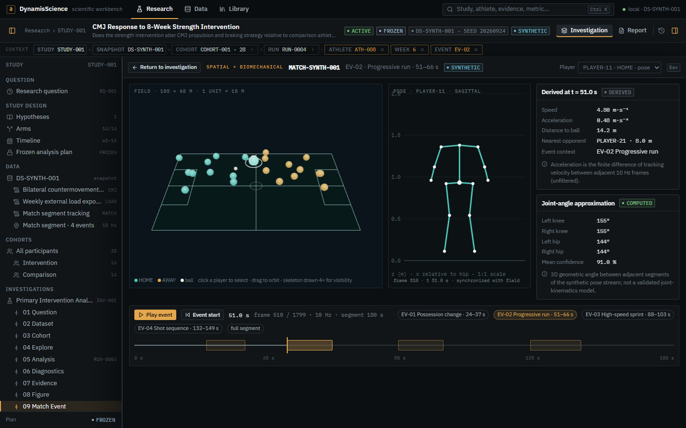 | **Spatial + biomechanical viewer.** Field, ball and articulated pose on one 10 Hz clock; event seeking, bounded playback, finite-difference kinematics, joint-angle approximations, and an explicit unavailable state for players without pose. |
| 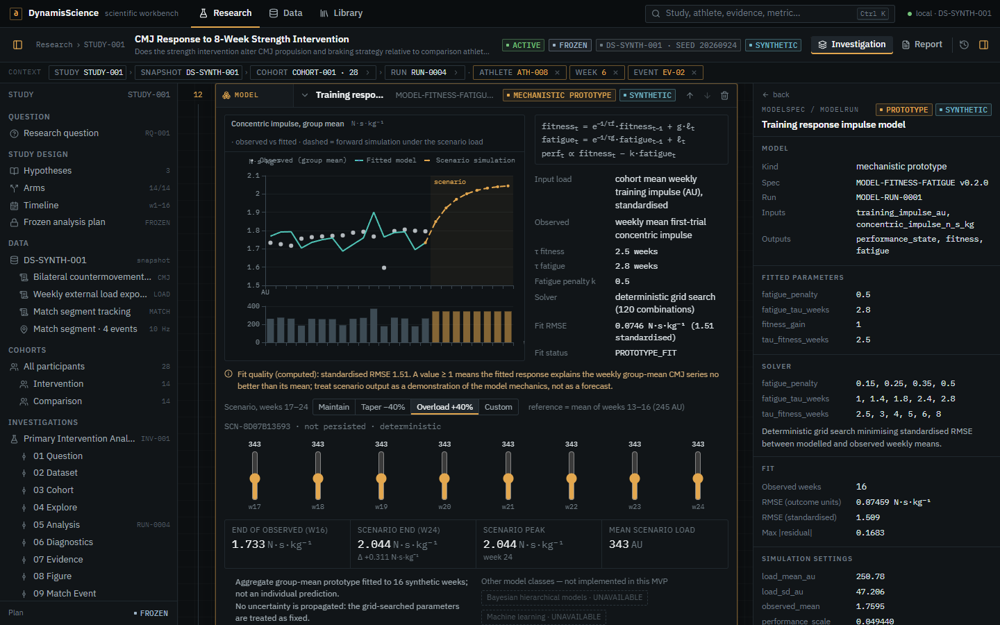 | **Mechanistic model block.** Observed versus fitted response, fitted parameters, solver grid, residuals, and a forward scenario whose output changes as the load plan changes. |
| 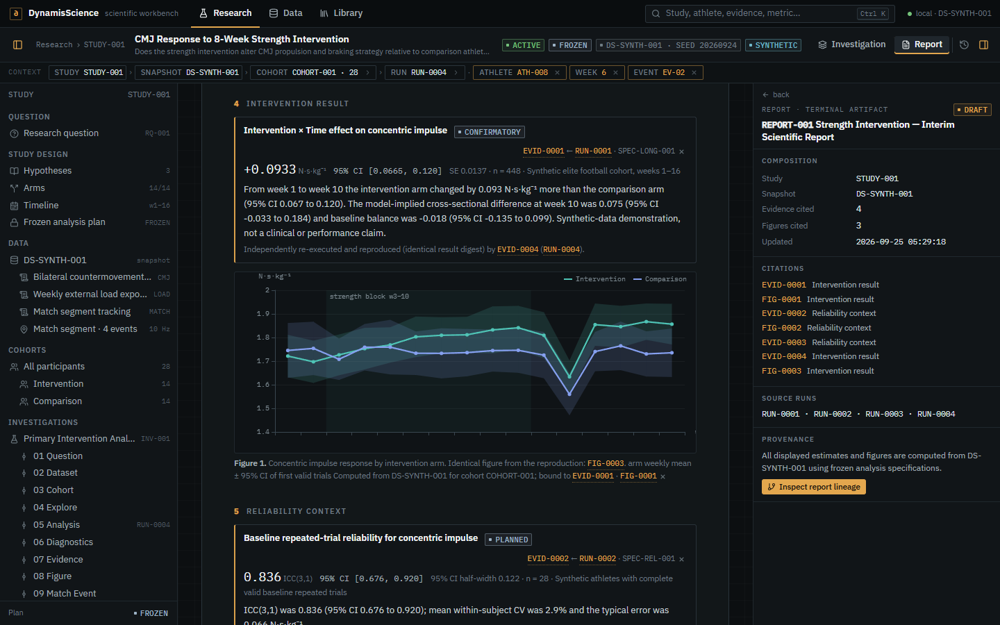 | **Evidence-driven report.** Built from cited evidence and figures; every number links back to its evidence, run and spec, and independent reproductions are reported once with their provenance. |
| 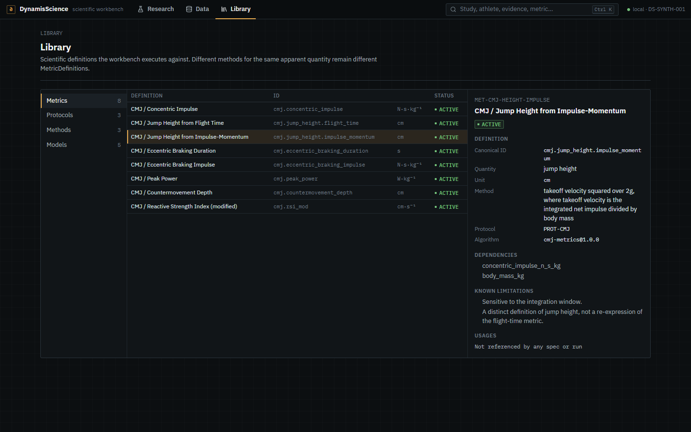 | **Scientific Library.** Metrics, protocols, methods and models — the same contracts the workbench executes. Two jump-height definitions share a unit but remain distinct definitions. |
| 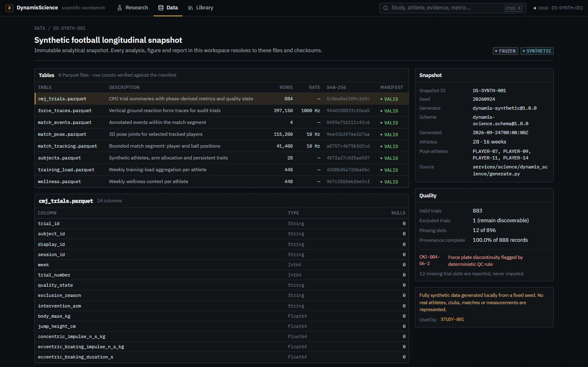 | **Dataset surface.** Tables, schemas, null counts, row counts verified against the manifest, SHA-256 checksums, quality and the synthetic-data disclaimer. |

## Architecture

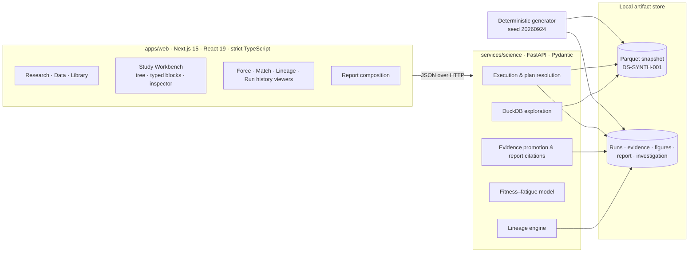

```text
DynamisScience/
├─ apps/web/
│  ├─ app/                      Research, Data, Library and study routes
│  ├─ components/workbench/     workspace shell, study tree, inspector, typed blocks
│  ├─ components/viewers/       force signal, match field + pose, lineage, run history
│  ├─ components/report/        report composition from cited artifacts
│  └─ lib/                      contracts, typed block model, lineage layout, display rules
├─ services/science/
│  ├─ dynamis_science/          generate · analysis · lineage · api
│  └─ tests/                    scientific and API contract tests
└─ docs/screenshots/
```

### Engineering decisions worth noting

- **The GUI is not the scientific authority.** Blocks hold references and configuration; values always come from the service, which computes them from the snapshot.
- **Content-addressed specifications and cohorts.** Identical configurations resolve to the same exploratory spec and draft cohort, which is what makes reproduction detection meaningful.
- **Reproducibility digest.** Runs hash their scientific payload (not timing or environment), so "this re-run reproduces RUN-0001" is a computed statement.
- **Evidence classes.** `CONFIRMATORY` (planned inferential), `PLANNED` (planned supporting) and `EXPLORATORY`; superseded evidence is derived, not hand-set.
- **Bounded payloads.** Aggregation happens server-side (DuckDB over Parquet); the browser receives athlete-week summaries and bounded traces, never whole tables.
- **Fit-consistent forward simulation.** Scenarios reuse the fitted parameters and the fit-window transform, so weeks 1–16 reproduce the fitted series exactly before extrapolating.

## Scientific methods

| Area | Method |
| --- | --- |
| CMJ metrics | Phase-aware extraction from 1000 Hz traces: flight-time jump height, concentric and braking impulse (trapezoidal net-force integration), braking duration, countermovement depth, peak force and power, RSI-mod |
| Intervention effect | `outcome ~ week + group + week:group`, week centred on week 1, athlete random intercept + slope (MixedLM), estimator ladder to GEE and cluster-robust OLS, primary contrast = difference in change week 1 → 10 with Wald 95% CI |
| Reliability | Balanced ICC(3,1) with Shrout–Fleiss 95% CI, within-subject CV, typical error (√MSE), smallest worthwhile change |
| Individual change | Baseline (weeks 1–2) vs post-block (weeks 9–10), standardised change, comparison with the typical error of a change — descriptive, not causal |
| Exploration | Athlete-week means of valid trials, arm mean ± t-based 95% CI across athletes, computed load peaks |
| Match context | Speed from tracking velocity, finite-difference acceleration, distance to ball, nearest opponent, geometric joint angles |
| Training response | Fitness–fatigue impulse-response model fitted by deterministic grid search, with residuals, RMSE and forward scenarios |

## Tech stack

**Science service:** Python 3.12 · FastAPI · Pydantic · NumPy · SciPy · statsmodels · Polars · DuckDB · PyArrow · pytest · uv
**Web:** Next.js 15 (App Router) · React 19 · strict TypeScript · TanStack Query · ECharts · React Flow · React Three Fiber / three.js · Vitest + Testing Library · self-hosted IBM Plex

## Running it locally

Requirements: Node.js 20+, pnpm 11+, Python 3.12+ and [`uv`](https://docs.astral.sh/uv/).

```bash
pnpm install
pnpm data:generate   # deterministic snapshot + seed artifacts (also resets local state)
pnpm dev             # science service on :8000, workbench on :3000
```

Open <http://localhost:3000>. The science service's OpenAPI documentation is at <http://localhost:8000/docs>.

## Testing and validation

```bash
pnpm data:generate
pnpm test        # Vitest (web) + pytest (science)
pnpm lint
pnpm typecheck
pnpm build
```

- **76 automated tests** (47 Python, 29 web) covering byte-deterministic regeneration, dataset structure, force-metric correctness, reliability maths, the difference-in-change estimand, computed diagnostics, planned-versus-exploratory resolution, run immutability, idempotent evidence promotion, reproduction detection, cohort resolution, exploration aggregates, path-scoped lineage, investigation ordering rules, scenario simulation, report citations, the typed block model, lineage layout and display rules.
- **Rendered end-to-end validation**: a scripted headless-browser walkthrough of the complete demo path (47 checks at 1440×900 and 1280×800) against the production build, with zero console or network errors.

## Status and limitations

This is a vertical-slice MVP built to demonstrate the product and its scientific discipline.

- All data are synthetic and have no external validity.
- Force traces are internally coherent demonstrations; flight time and propulsive impulse are generated independently, so the impulse-momentum jump-height definition is registered but deliberately not materialised.
- The longitudinal model uses a linear week term; the week-11 load spike and week-12 suppression appear as structured residuals, which the diagnostics surface.
- The training-response model is an aggregate prototype; on this dataset its standardised fit RMSE exceeds 1, which the workbench states explicitly.
- Metadata lives in local JSON behind a replaceable adapter; there is no authentication or multi-tenancy.

## Licence

**Copyright © 2026 Julio Rodriguez. All rights reserved.**

This repository is public for portfolio viewing only. No permission is granted to copy, distribute, modify, deploy or otherwise use any part of it without prior written permission. See [LICENSE](LICENSE) for the full terms.
