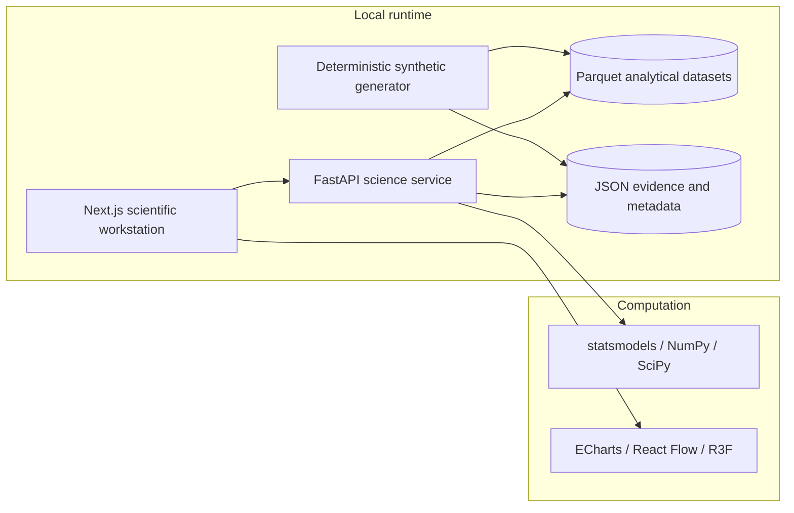

# DynamisScience

DynamisScience is a local-first scientific computation and evidence workspace for sports scientists. It demonstrates the scientific layer of the broader DynamisSystems ecosystem: a question becomes a cohort, a method, a diagnostic, an evidence artifact, and a reproducible report.

The MVP is deliberately not an athlete-management system, a BI dashboard, or an AI chat surface. It is a deterministic instrument for inspecting how a result was calculated and what supports it.

## Product philosophy

The central workflow is:

```text
Question → Data → Cohort → Method → Analysis → Diagnostics → Evidence → Interpretation → Report
```

The interface keeps the computational boundary visible:

- `DatasetSnapshot` is an immutable analytical input.
- `AnalysisSpec` is the machine-readable authority for an execution.
- `AnalysisRun` is append-only and retains its environment and diagnostics.
- `EvidenceArtifact` is a first-class result, not a chart decoration.
- `MetricDefinition` distinguishes methods even when units match.
- `LineageEdge` makes the route from report back to measurement inspectable.

## Architecture



```text
DynamisScience/
├─ apps/web/                    Next.js + React + TypeScript workstation
├─ services/science/             FastAPI, generator, analysis, tests
├─ packages/contracts/           shared typed domain contracts
├─ packages/ui/                 UI package boundary
├─ data/synthetic/               generator manifest
├─ data/parquet/                 local analytical tables
├─ data/artifacts/               evidence, runs, registry, lineage
├─ scripts/                      local operational scripts
└─ tests/                        repository-level test boundary
```

The local filesystem is an explicit adapter boundary. A future deployment can replace Parquet with object storage, local metadata with PostgreSQL, and the local service with durable compute workers without changing the domain contracts.

## Local setup

Requirements:

- Node.js 20+
- pnpm 11+
- Python 3.12+
- [`uv`](https://docs.astral.sh/uv/)

No API keys, hosted AI, cloud database, or external data provider is required.

```bash
pnpm install
pnpm data:generate
pnpm dev
```

Open `http://localhost:3000`. The local science service runs at `http://localhost:8000`; its OpenAPI surface is available at `http://localhost:8000/docs`.

The data generator uses the fixed seed `20260924` and creates:

- 28 synthetic athletes across multiple football positions and two intervention arms
- 16 weekly observations with two CMJ trial summaries per week
- 397,150 force samples at 1000 Hz for selected audit trials (all trial summaries remain available)
- weekly training-load and wellness observations
- four annotated match events in a 10 Hz, 1,800-frame match segment
- 22 players, a ball, and synchronized 3D pose streams for selected players
- an explicitly flagged bad trial and realistic contextual missingness

Regeneration is deterministic for the analytical tables and semantic artifacts. The snapshot manifest records generator version, schema version, seed, row counts, and SHA-256 checksums.

## Main routes

| Route | Purpose |
| --- | --- |
| `/` | Scientific command center |
| `/#studies` | Study, frozen plan, hypotheses, cohort, protocols |
| `/#monitor` | Individual longitudinal CMJ, load, match, wellness context |
| `/#forcelab` | Force trace, phases, metrics, evidence passport |
| `/#matchlab` | Synchronized 3D field and pose workspace |
| `/#analyses` | Typed analysis DAG and executable methods |
| `/#models` | Fitness–fatigue mechanistic prototype and scenario simulation |
| `/#runs` | Immutable execution ledger |
| `/#registry` | Metrics, protocols, algorithms, methods, models |
| `/#reports` | Evidence-linked interim report |
| `/#lineage` | Provenance graph and backward route |

## Science service API

The service exposes coherent domain routes including:

```text
GET  /health
GET  /overview
GET  /studies
GET  /studies/{id}
GET  /subjects
GET  /subjects/{id}/longitudinal
GET  /force/trials
GET  /force/trials/{id}
GET  /match/{id}/tracking
GET  /match/{id}/pose
GET  /registry/metrics
GET  /registry/protocols
GET  /runs
GET  /runs/{id}
POST /analyses/execute
GET  /evidence
GET  /evidence/{id}
GET  /lineage/{artifact_id}
GET  /models/training-response
POST /models/training-response/simulate
```

## Scientific methods implemented

### CMJ metric extraction

Selected force traces are sampled at 1000 Hz and labelled through quiet standing, unweighting, braking, propulsion, flight, and landing. Metrics are calculated from the trace rather than copied from a display-only value:

- jump height from takeoff-to-landing flight time
- concentric impulse from trapezoidal net GRF integration during propulsion
- eccentric braking impulse and duration from phase boundaries
- countermovement depth from integrated displacement
- peak force from the vertical GRF maximum
- peak power from force × velocity during propulsion
- RSI-mod from jump height and propulsion duration

### Group longitudinal analysis

The preferred model is a repeated-subject group × time model:

```text
outcome ~ week + group + week:group
random intercept = athlete
```

`statsmodels MixedLM` is attempted first. When the synthetic design produces an unstable random-effects fit, the service records a documented repeated-subject OLS fallback and exposes that choice in the run diagnostics. The returned contrast is the intervention-minus-comparison estimate at week 10 with standard error and 95% confidence limits.

### Reliability

Repeated valid baseline trials are used to calculate:

- within-subject coefficient of variation
- typical error
- ICC(3,1)
- the number of complete subjects and trials per subject

### Individual change

Baseline weeks 1–2 are compared descriptively with post-block weeks 9–10. The UI reports baseline mean, observed change, percentage change, standardized change, and typical-error context without presenting the result as a causal individual inference.

### Training response prototype

ModelLab fits a small fitness–fatigue impulse-response model to generated weekly training impulse and CMJ observations. Users can change load and time-constant parameters and run a local simulation. It is labelled `Mechanistic prototype` and `Synthetic demonstration`; it does not claim to be a readiness model, injury model, or individual predictor.

## Reproducibility model

Every run records:

- `AnalysisSpec` and planned contrasts
- snapshot ID and seed
- cohort ID and exclusion rule
- method and algorithm version
- software versions
- parameters
- result and diagnostics
- output artifact references
- reproducibility key

The generator and analytical artifacts are local files. Bad trials are not silently removed: they remain visible in the trial registry with a quality state and exclusion reason.

## Validation

```bash
pnpm data:generate
pnpm test
pnpm lint
pnpm typecheck
pnpm build
```

The Python suite covers deterministic regeneration, schemas, force metrics, reliability, longitudinal analysis, mechanistic simulation, and evidence metadata. The web suite covers scientific display contracts. The production build type-checks the Next.js workstation and compiles the React Flow, ECharts, and React Three Fiber integrations.

## Known MVP limitations

- The dataset is synthetic and has no external validity.
- Force signals are internally coherent demonstrations, not a validated biomechanical simulator.
- The statistical model is a small repeated-subject MVP, not a full causal inference platform.
- The training-response model is an aggregate mechanistic prototype.
- Local JSON metadata is intentionally replaceable; it is not a production metadata database.
- There is no authentication, multi-tenant control plane, distributed scheduler, or GPU executor in this MVP.

## Production evolution

```text
Local Parquet              → object storage + columnar lakehouse
Local metadata JSON        → PostgreSQL + controlled migrations
Local FastAPI process      → API gateway + durable compute workers
Current statistics         → Bayesian / ML / PIML executors
Synthetic generator        → DynamisETL contracts and provenance events
```

The contracts, snapshot boundary, run ledger, evidence objects, and lineage graph are designed to remain stable while these infrastructure adapters are replaced.
