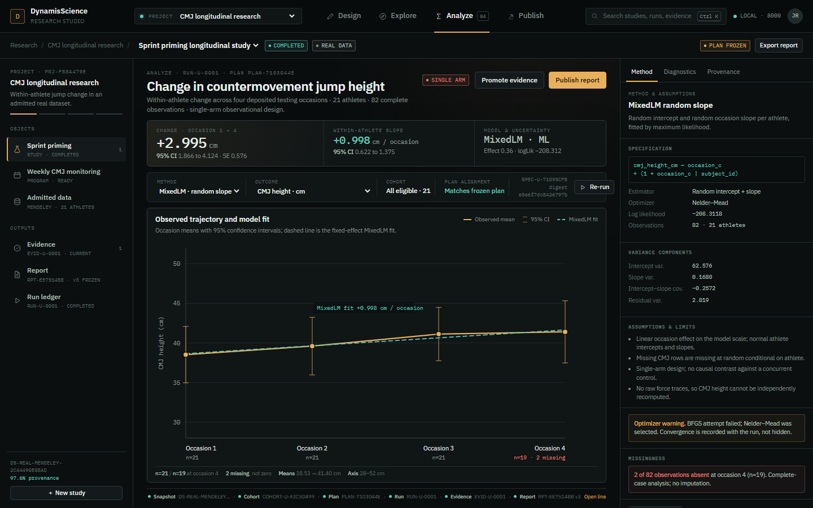
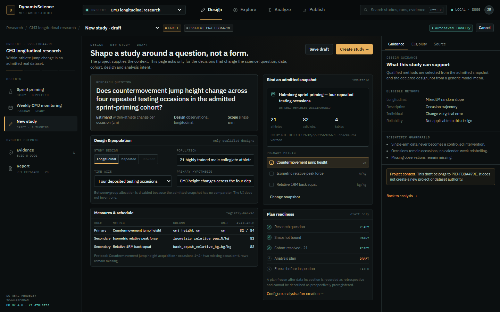
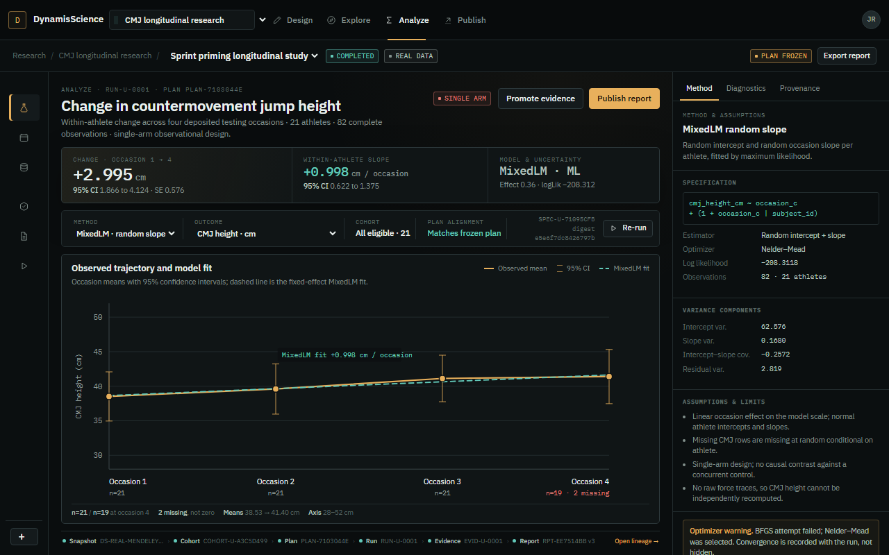
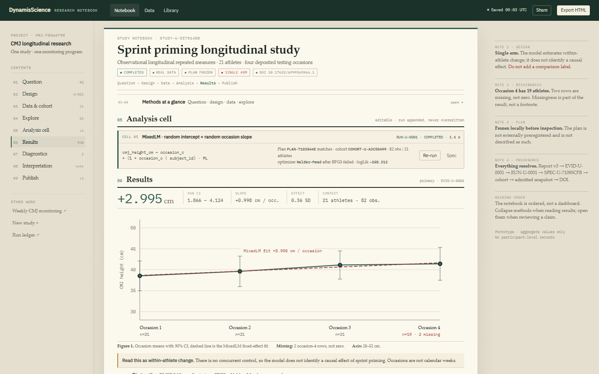
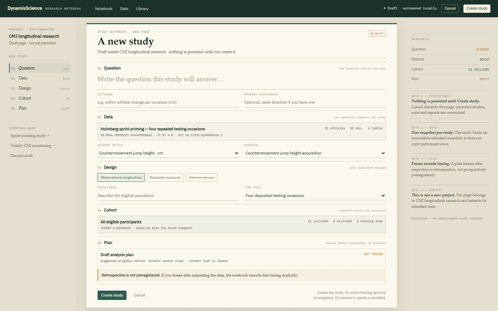
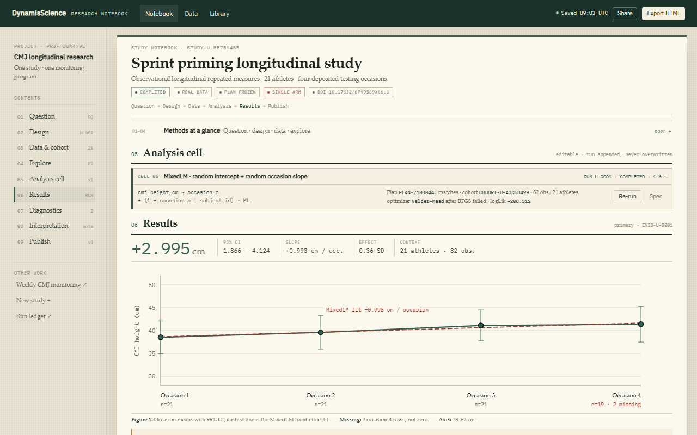
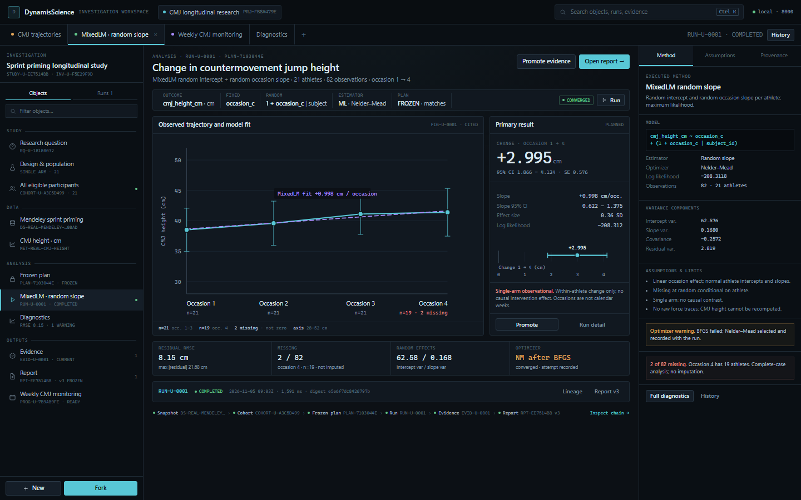
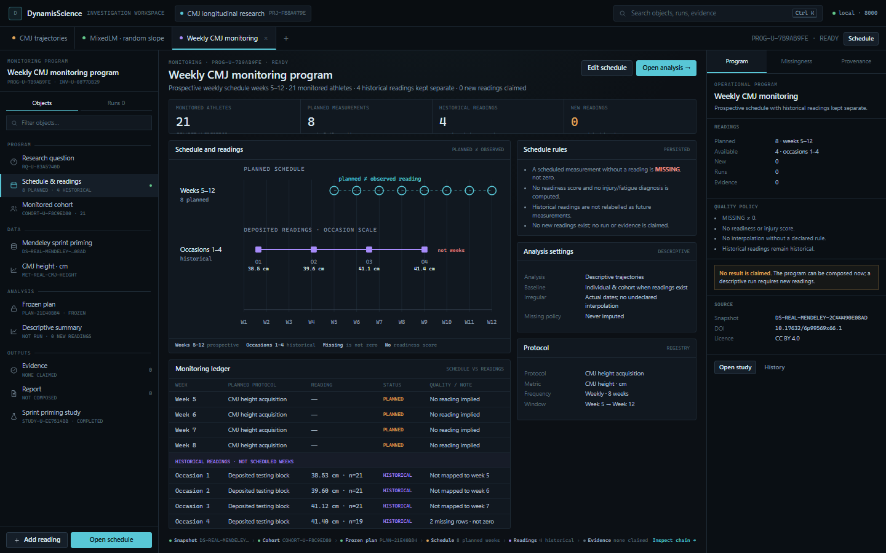
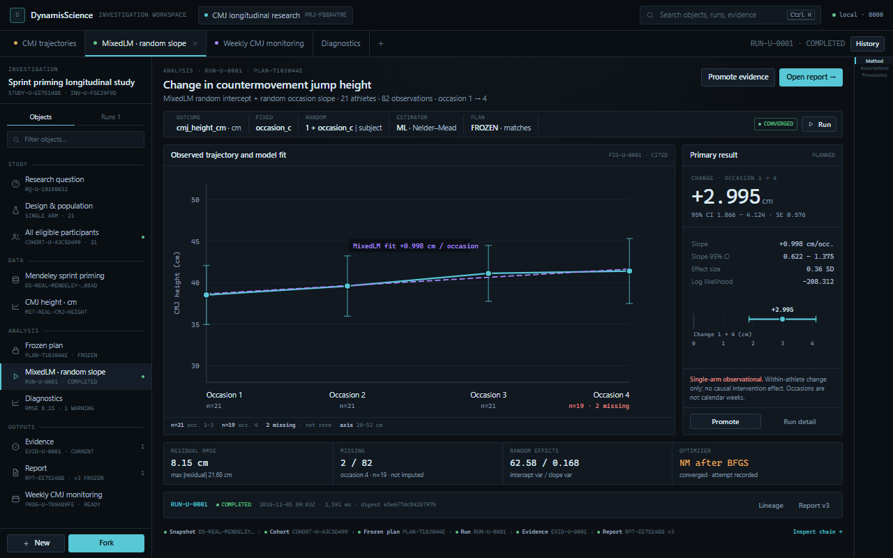

# RES-588 — Step A UX audit and Step B design directions

Status: **Step A + Step B complete. Production UX untouched. Owner decision required.**
Date: 2026-11-05 · Native Windows / PowerShell · production build served at
`http://localhost:3001` with the local science service at `http://127.0.0.1:8000`.

> **Owner follow-up.** After reviewing A, B and C, the owner requested a hybrid
> that is more insightful, intuitive, simple, non-invasive and crafted.
> **Direction D — The Research Atelier** was added as that synthesis. After the
> owner asked “what is this for / what do I do with it?”, **Direction E —
> Fieldlab** was added as the decision-first impact design. The owner then asked
> whether the product truly supports daily sports-science practice; the
> **Sports Science Design Pattern — Dynamis Performance OS**
> ([`SPORTS_SCIENCE_DESIGN_PATTERN.md`](SPORTS_SCIENCE_DESIGN_PATTERN.md)) defines
> the full practice model, modules, models, components, charts and units, with a
> synthetic-data Squad Command exemplar. It is the latest deliverable. See
> [`RES-588_UX_DIRECTION_E_FIELDLAB.md`](RES-588_UX_DIRECTION_E_FIELDLAB.md) and
> [`RES-588_UX_DIRECTION_D_ATELIER.md`](RES-588_UX_DIRECTION_D_ATELIER.md).
> Directions A, B and C remain in this document as the evidence base; they are
> not withdrawn.

This document records the evidence-based audit and three rendered design
directions required by Section 11 of RES-588. It does **not** claim visual
approval. No production component, route, backend contract, dataset, research
record, report or evidence artifact was modified during this gate.

## 1. Method

The current application was inspected as a production build, not from README
screenshots. The audit walked the persisted real-data work:

- Research → CMJ longitudinal research → Sprint priming longitudinal study
- Study setup, Investigation, Explore, Analysis, Diagnostics, Evidence, Figure
  and Report modes
- Monitoring program → Weekly CMJ monitoring program
- The second real-data study → MoveSmart wearable force-plate measurement study
- Data, dataset detail, source admission and Library

The walkthrough was read-only. Existing persisted studies, runs, evidence and
reports were opened; nothing was created, frozen, executed or promoted.

Rendered capture was performed at **1440 × 900**, **1280 × 800** and
**1024 × 800** with Chromium. The audit measured layout geometry, scroll
distance, interactive-control counts and request failures. Keyboard behaviour
was checked with `Ctrl+K` and `Escape`.

Artifacts:

- Production captures and measurements: `docs/design/res588-ux/audit/production/`
- Design renders: `docs/design/res588-ux/screens/`
- Comparison sheets: `docs/design/res588-ux/compare/`
- Static, read-only prototypes: `docs/design/res588-ux/prototypes/`
- Reproduction scripts: `scripts/res588_ux_audit.py`,
  `scripts/res588_ux_interactions.py`, `scripts/res588_render_designs.py`,
  `scripts/res588_capture_gallery.py`

## 2. What already works and must remain intact

The audit found substantive strengths that a redesign must not discard:

1. **The scientific engine is real.** The Mendeley MixedLM run is persisted with
   estimator attempts, convergence, variance components, residuals, missingness,
   digest and frozen-plan alignment. The computed result is +0.998 cm per
   occasion (95% CI 0.622–1.375) and +2.995 cm from occasion 1 to 4 (95% CI
   1.866–4.124), from 82 observations in 21 athletes.
2. **The diagnostics surface is unusually good.** `RMSE 8.15 cm`, residual
   means by occasion, Q–Q plot, missingness, assumptions and the BFGS→Nelder–Mead
   warning fit on one screen and are directly reviewable.
3. **Source admission and the Data/Library surfaces are strong.** Rights,
   licence evidence, privacy classification, checksums, row counts, variable
   dictionary, metric definitions and provenance are present and dense without
   becoming decorative.
4. **The evidence and persistence model is real.** `RUN-U-0001` is append-only;
   `EVID-U-0001` is current and cited; report `RPT-EE7514BB` v3 is frozen with a
   content hash; the exported HTML contains a machine-readable manifest.
5. **The command palette, native buttons, visible focus rings and resizable
   panes are real keyboard surfaces.** `Ctrl+K` opens and `Escape` closes the
   palette in the production build.
6. **The scientific copy is honest.** Single-arm limitation, occasions versus
   weeks, missing-not-zero and non-causal interpretation are stated in the
   analysis, diagnostics and report.

These are preserved in all three directions. The redesign is about the
interaction model around the science, not replacement of the science.

## 3. Observed structural problems

### UX-01 — The primary result is buried under protocol metadata

At 1440 × 900 the study workbench gives the work column **828 px**. The bench
contains **3,894 px** of content in a **780 px** viewport: **5.0 screens** of
scrolling. The first block (Question) is **470 px** tall. The Analysis block
starts at document y=**1,402**; the primary figure starts at y=**3,151**.
The primary plot is **724 × 260 px**.

At 1280 × 800 the work column is **668 px**, the chart is **564 × 260 px**, and
it starts at y=**3,724**. At 1024 × 800 the tree and inspector auto-collapse;
the chart grows to **920 × 260 px** but starts at y=**3,856**.

The first screen is therefore protocol metadata, plan cards and dataset
metadata. The scientific result is not visible until roughly 3.5 viewport
heights of scrolling.

**Evidence:** `study-mendeley-1440x900.png`, `study-mendeley-figure-1440x900.png`,
`metrics.json`, `interaction-audit.json`.

### UX-02 — The three-pane shell consumes 42.5% of a 1440 px screen

The fixed geometry is 256 px Study Tree + 828 px work + 356 px Inspector. The
two side panes consume **612 px (42.5%)**. The Inspector often repeats the plan
metadata already shown in the main Question block, while the Study Tree repeats
the same block list in another form. The work column is narrower than the two
side panes combined.

At 1280 the title truncates (`Sprint priming lon…`) and the snapshot ID is clipped
in both the tree and dataset rows. At 1024 the panes disappear automatically with
no in-context replacement; the researcher can no longer see cohort or method
context while looking at the result.

### UX-03 — One long block document conflates four different research tasks

The workbench presents 10 blocks in one scroll: Question, Dataset, Cohort,
Explore, Analysis, Diagnostics, Evidence, Figure, Interpretation, Report
Section. The page exposes **123 visible buttons/links**, **28 inputs** and **3
canvases**. Design, exploration, analysis, evidence and publishing are all the
same surface, ordered by implementation dependency rather than research intent.

This is why the result sits below the cohort and dataset blocks. It also means
there is no stable answer to “where am I?” beyond the mode switch
`Investigation / Setup / Report`.

### UX-04 — Navigation and state are duplicated in five forms

The same objects and states appear in the global bar, study bar, context bar,
Study Tree and block list. `DS-REAL-MENDELEY-2C44490E08AD` appears **7 times** on
one study page; “Occasions” appears 4 times. The context bar, tree, block
headings and Inspector all present state chips (`COMPLETED`, `FROZEN`,
`IMMUTABLE`, `REAL DATA`, `PLANNED`). The result is high information density
without a stable hierarchy.

### UX-05 — Project, study, monitoring program and investigation are not clearly separated

`/research` shows a project list and a separate flat “Studies” list containing
five research objects, including the legacy seeded `STUDY-001`,
`STUDY-REAL-001` and `STUDY-REAL-002`. Opening a project then repeats its study
and monitoring program. “Investigation” is both a mode in the study bar and a
group in the Study Tree. The vocabulary is internally consistent but not
self-explanatory to a scientist.

### UX-06 — The mode names describe implementation, not research activity

`Investigation` contains the long document and the analyses. `Setup` contains
authoring. `Report` contains publishing. A researcher thinks in
**Design → Explore → Analyze → Publish**, which is the candidate model in
Section 11. The current names force the user to learn the implementation
decomposition before doing research.

### UX-07 — The default Explore state fails on the real Mendeley study

Opening the real study loads the Explore block with **20 m sprint time** as the
default metric. The request returns **HTTP 422**:
`/explore/longitudinal?metric_id=MET-REAL-SPRINT-20M… — sprint_trials has no row
axis`. The block displays “Computation unavailable” instead of a time-series
plot. Six 422 responses were recorded across the audit runs.

This is not cosmetic. The Linear-required workflow “explore Mendeley time series”
fails in its default state. The production audit previously reported zero
console errors; the 422 is a handled request failure, but it is still a real
blocked workflow.

**Evidence:** `study-mendeley-explore-block-1440x900.png`,
`runtime-*.json`.

### UX-08 — The real-data figure carries synthetic-study semantics

The Figure block for the single-arm Mendeley study renders:
`strength block w3–10` and a legend `Intervention / Comparison`.

The study has no comparison arm, no intervention and no week 3–10 block. This is
a scientific-visualization correctness defect, not a styling issue. It directly
contradicts the project’s stated limitations and must be corrected before any
design direction is accepted.

**Evidence:** `study-mendeley-figure-1440x900.png`.

### UX-09 — Monitoring is a form and a list, not a longitudinal view

The Weekly CMJ monitoring program shows planned counts and week chips but no
timeline. The first canvas is at y=**1,645** at 1440, **1,849** at 1280 and
**1,583** at 1024. Planned weeks 5–12 and the four historical readings are kept
conceptually separate (correct) but are not visually comparable. The program
cannot be read as a longitudinal monitoring object at a glance.

### UX-10 — Report mode retains the full workbench chrome

In Report mode the Study Tree and Inspector remain fixed. The report is
**828 px** wide at 1440; the first chart is **664 × 260 px** at y=**1,056**. The
result is below the fold, and `Freeze version`, `Export HTML`, `Lineage` and
`Inspector` compete in the same visual band. Publishing is not a distinct,
focused task.

### UX-11 — The project home is an administrative shell

The project page is mostly empty below two cards and two lists. There is no
recent run, current evidence, report status, next action, monitoring status or
project-level narrative. A scientist opening a project cannot see what changed
or what to do next.

### UX-12 — The command palette leaks unrelated context

`Ctrl+K` from the Mendeley study offers:

- `Open study · CMJ Response to 8-Week Strength Intervention` (`STUDY-001`)
- `ATH-001 · GK · intervention`, `ATH-002`, etc.
- `Open dataset DS-SYNTH-001`

These are synthetic RES-116 objects, not the current project. The palette is a
global index with no project scoping. This is a context-leak risk and a source
of confusion between real and synthetic research.

### UX-13 — Responsive behaviour trades context for width

At 1280 the title truncates, the primary hypothesis field becomes a narrow
column, and long IDs are clipped. At 1024 the tree and inspector vanish and the
canvas becomes 1,024 px wide, but the plot remains 260 px tall at y=3,856. The
layout adapts by removing context, not by restructuring the task.

### UX-14 — Accessibility observations

`Ctrl+K` works and native controls are focusable. However:

- The first 12 tab stops are global shell controls before any study content.
- Study Tree labels truncate with ellipsis and do not expose a tooltip for every
  item.
- Many controls are 9–10 px mono text with low-contrast muted labels.
- There is no skip link to the main analysis surface.
- The mode switch does not expose the current activity in the document title or
  a landmark.
- The Inspector tabs are visual only in the prototype; in production they are
  not implemented as tabs with arrow-key semantics.

A future implementation must include a skip link, roving focus for mode/tab
groups, visible focus states, and a keyboard path that reaches the chart and
method controls without traversing the entire tree.

## 4. What the redesign must achieve

From the audit and Section 11:

1. Put the **scientific result and the primary plot on the first screen**.
2. Make the task modes explicit: **Design → Explore → Analyze → Publish**.
3. Keep **project → study/program → investigation** legible without repeating
   every object in five places.
4. Give the plot **space** (target: at least 700 × 350 px at 1440, at least
   600 × 300 px at 1280) and keep methods, uncertainty, missingness and
   provenance available in a contextual surface.
5. Make **study creation** a design act, not a form grid or wizard.
6. Make **monitoring** visibly longitudinal: planned schedule and historical
   readings in separate, honest lanes.
7. Preserve every scientific, persistence and provenance behavior.
8. Reduce the number of meaningful transitions to the flagship result, not the
   number of pixels.

## 5. Three design directions

All three use the same real study and the same aggregate values. No
participant-level records are present. Screenshots are at 1440 × 900 unless
stated; the compact treatment is at 1280 × 800.

### Direction A — Focused Research Studio

**Thesis.** A project-centred studio with four deliberate activity modes and one
large scientific stage. The researcher always knows the project, the study and
the current activity; the result is the first thing on screen.

**Information architecture**

- Persistent project switcher in the global bar.
- Activity modes: **Design / Explore / Analyze / Publish**.
- Slim project context rail: study, monitoring program, data, evidence, report,
  run ledger.
- Central stage for the active activity.
- Right contextual inspector: **Method / Diagnostics / Provenance**, with the
  selected section always visible.
- Persistent lineage strip:
  Snapshot → Cohort → Frozen plan → Run → Evidence → Report.

**Flagship Analyze screen**

- Header: “Change in countermovement jump height”, 21 athletes, 82 observations,
  single-arm chip.
- Result band: +2.995 cm [1.866, 4.124], +0.998 cm/occasion [0.622, 1.375],
  model and uncertainty.
- Compact analysis bar: method, outcome, cohort, plan alignment, run, Re-run.
- **784 × 405 px chart** at 1440; **832 × 307 px** at 1280.
- Methods, variance components, optimizer warning and missingness are in the
  right dock, not on top of the chart.
- The inspector remains visible at 1280; only the project rail becomes icons.

**Second view: Design — create a study**

One canvas, not a wizard. The research question is the dominant element. Data
binding, design, population, measures and plan readiness are adjacent. The
project already contains a completed study and a monitoring program; the draft
is explicitly “not yet persisted”. The primary action is `Create study`; the
bottom of the page is not a second form.

**Provenance, methods and limitations**

Always visible: single-arm chip, result-band CI, chart-foot missingness, lineage
strip, inspector tabs. The inspector contains the formula, variance components,
assumptions, optimizer warning and missingness. Nothing scientific is hidden
behind a decorative “insights” surface.

**Keyboard and accessibility**

Native buttons and selects; activity modes are links/buttons with an obvious
current state; the tab order should be global bar → project → modes → analysis
toolbar → chart → inspector. A skip link and roving focus are required in the
implementation. The inspector tabs must use `role="tablist"` with arrow-key
support. The large chart has a text summary in the result band for screen
readers.

**Transitions to the flagship result**

From `/research`: open project (1) → study opens directly in Analyze (1) →
adjust/rerun (1) → promote evidence (1) → publish report (1). **4–5 meaningful
transitions**, versus 7–9 in the current shell.

**Implementation cost and risk relative to the codebase**

**Medium.** The shell, route modes and layout are new, but the science surfaces
can be composed from existing `AnalysisBlocks`, `DiagnosticsBlock`,
`EvidenceBlocks`, `FigureBlock`, `Inspector`, `ReportDocument`, the ECharts
helpers and the existing API. No backend or persistence change is required.
The main risk is mapping 16 block types into four activity modes without losing
deep links or collapse/reorder state. This is the lowest-risk direction that
still changes the product structure.

**Compromises**

- The project rail is less expansive than the current Study Tree; it must still
  expose block-level navigation in Explore/Analyze.
- A four-mode shell can hide cross-mode context; the persistent result band and
  lineage strip are essential.
- The inspector remains a dense column at 1440; it should be collapsible on
  smaller screens.

**Rendered evidence**





### Direction B — Scientific Notebook

**Thesis.** A study is an ordered research narrative. The notebook is the
product: sections, computational cells, collapsible methods, a full-width figure
and persistent contents. It is optimised for reading, reviewing and publishing
a study, not for dashboard scanning.

**Information architecture**

- Global top bar with project breadcrumb and Notebook / Data / Library.
- Persistent contents rail with numbered sections and page-like active state.
- A paper-like page with a clear header, status stamps and narrative position.
- **Methods at a glance** collapses sections 01–04 into one line; opening it
  reveals question, design, data and exploration.
- Analysis is an editable computational cell with spec, run status, plan match
  and rerun.
- Results are a full-width figure with a large serif result line and a figure
  caption.
- Diagnostics, interpretation and publish follow in reading order.
- Margin notes hold uncertainty, missingness, plan timing and provenance.

**Flagship Results screen**

- The page opens with a readable title and the methods collapsed.
- The cell is compact; the result line is `+2.995 cm [1.866, 4.124]`.
- **834 × 310 px figure** at 1440; **994 × 270 px** at 1280.
- Margin notes: single-arm, occasion-4 n=19, 2 missing, plan frozen locally, full
  provenance chain.
- The report/publish block is part of the same narrative, not a separate mode.

**Second view: New study**

A blank notebook page authored as ordered cells: question, data, design, cohort,
plan. The sidebar shows readiness. The margin states that nothing is persisted
until `Create study`, one snapshot per study, and retrospective freeze semantics.
This is a genuine authoring metaphor, not a form grid.

**Provenance, methods and limitations**

The notebook puts methods in collapsible sections and margin notes. Provenance is
a note chain; diagnostics is a collapsible section; missingness is a margin note.
The full-width figure has an explicit caption and an axis note.

**Keyboard and accessibility**

Native `<details>` elements provide disclosure; the contents rail is anchor-based
and can open the relevant disclosure. Focus order follows reading order, which
is strong for review but long for iterative work. Print/PDF behaviour is a
first-class requirement; the light paper palette needs a dark-mode variant and
contrast validation.

**Transitions to the flagship result**

Contents → Results (1 click). Authoring and running an analysis requires
scrolling through cells and returning to the analysis cell; **5–6 meaningful
transitions**. The notebook is best when the study is already designed.

**Implementation cost and risk relative to the codebase**

**High.** It requires a new notebook-cell authoring model, a block-to-cell
mapping, narrative ordering, print layout, a light visual system and new
interaction semantics for editing and running cells. The existing block model
can back the cells, but the prose-first editor, keyboard behaviour and
persistence mapping are substantial new product surface. It has the highest
design differentiation and the highest regression risk.

**Compromises**

- Reading is excellent; rapid model tuning and cross-object comparison are weaker.
- Long studies become long pages even with collapsed methods.
- The paper metaphor can look editorial rather than operational; monitoring and
  run history need a different treatment.
- A light theme alone is not a redesign; the cell/narrative model is the real
  proposal.

**Rendered evidence**





### Direction C — Investigation Workspace

**Thesis.** A research-object workspace for power users: a navigator of real
objects, multiple open analysis tabs, a task-focused canvas and an instrument
tray. It keeps several scientific objects in view at once without turning into
node spaghetti.

**Information architecture**

- Global bar and project pill.
- Open-object tab bar: CMJ trajectories, MixedLM, monitoring, diagnostics,
  report.
- Left research-object navigator grouped by Study, Data, Analysis, Outputs,
  Monitoring.
- Central canvas with a model ribbon and two-column chart/result stage.
- Right contextual instrument tray: Method, Assumptions, Provenance.
- Bottom diagnostics strip and a compact lineage chain.

**Flagship Analyze screen**

- Ribbon: outcome, fixed effect, random effect, estimator, plan alignment,
  convergence, Run.
- **594 × 338 px chart** at 1440 with a separate result panel and forest plot;
  **732 × 360 px** at 1280 when the tray becomes a rail.
- Diagnostics (RMSE, missingness, variance components, optimizer warning) are a
  single strip under the chart.
- Run ledger and lineage remain visible at the bottom.

**Second view: Monitoring program**

- Summary strip: 21 monitored, 8 planned, 4 historical readings, 0 new readings.
- Two-lane timeline: planned weeks 5–12 (hollow) and historical occasions 1–4
  (separate scale, explicitly “not weeks”).
- Ledger separates planned weeks from historical readings; no reading is
  invented; missing is not zero.
- Right instruments: schedule rules, analysis settings, protocol, provenance.

**Provenance, methods and limitations**

The navigator exposes the frozen plan, run and evidence as objects. The tray
shows method, assumptions and provenance. The lineage bar is a compact chain
rather than a graph. The monitoring screen’s rules are visible and explicit.

**Keyboard and accessibility**

Tabs need full ARIA tab semantics and focus management. The object navigator is
a list, so arrow-key navigation is feasible. The density is higher: small text
(8–10 px) and many simultaneous panels increase cognitive and visual load. A
compact mode must preserve focus order and not hide the result panel.

**Transitions to the flagship result**

Open project → analysis tab (1) → rerun/promote (1–2) → report tab (1).
**3–4 meaningful transitions**, the shortest of the three. The cost is more
concurrent context and more implementation state.

**Implementation cost and risk relative to the codebase**

**Medium–High.** It can reuse the existing block components as canvas panels and
the existing API directly, but it needs tab state, navigator state, a docking/
tray model and careful responsive focus management. The risk is recreating a
tool that is powerful for the author but intimidating for a new scientist.

**Compromises**

- Highest density and the highest learning curve.
- Multiple panels can hide the primary result at smaller widths.
- Docking/tab persistence is new state that must not leak across investigations.
- The monitoring view is excellent, but the analysis view risks feeling like an
  IDE rather than a research studio.

**Rendered evidence**





## 6. Comparison

| Dimension | Current | A · Focused Studio | B · Notebook | C · Workspace |
|---|---|---|---|---|
| Primary result on first screen | No — chart at y=3,151 | **Yes** — chart at y=419 | Yes — chart at y=508 | Yes — chart at y=241 |
| Plot size at 1440 | 724 × 260 | **784 × 405** | 834 × 310 | 594 × 338 |
| Plot size at 1280 | 564 × 260 | **832 × 307** | 994 × 270 | 732 × 360 |
| Task modes | Investigation / Setup / Report | **Design / Explore / Analyze / Publish** | Narrative sections | Object tabs |
| Project/study/program clarity | Weak (flat lists, duplicate objects) | **Strong** (project rail + study switch) | Strong (project contents) | **Strong** (object navigator) |
| Study creation | Form under project page | **One design canvas** | Ordered notebook cells | Object/canvas authoring |
| Monitoring | Counts and chips | Good (mode + timeline) | Weak (narrative page) | **Excellent (two-lane timeline)** |
| Method/uncertainty inspection | Docked inspector | **Docked inspector** | Margin notes + collapsed methods | Instrument tray |
| Provenance | Distributed across 5 surfaces | **Persistent lineage strip** | Margin note + chain | **Compact lineage bar** |
| Power-user efficiency | Medium | High | Medium (reading) | **Highest** |
| New-user clarity | Low | **Highest** | High for reading | Medium |
| Implementation cost | — | **Medium** | High | Medium–High |
| Regression risk | — | **Medium** | High | Medium–High |
| Fit to Section 11 | Rejected | **Direct** | Strong for Publish | Strong for monitoring/power users |

## 7. Recommendation

**Recommend Direction A — Focused Research Studio.**

It is the strongest balance of product change, scientific legibility and
implementation risk:

- It directly implements the candidate `Design / Explore / Analyze / Publish`
  model from Section 11 without inventing a fourth product.
- It puts the result and a **784 × 405 px** plot on the first screen at 1440 and
  keeps an **832 × 307 px** plot at 1280, while still retaining a real method,
  diagnostics and provenance inspector.
- It resolves the project/study/program confusion with a persistent project rail
  and a study switcher, and it gives study creation a dedicated design canvas.
- It reuses the working scientific components and the existing API/persistence
  layer. There is no backend rewrite, no new data authority and no paid service.
- It is the most defensible direction for a sports scientist who needs to
  configure a model, inspect uncertainty, promote evidence and publish a report
  in one coherent context.

It should borrow two elements from the other directions:

- **From B:** the readable report/publish treatment, collapsible methods and
  margin-note discipline for limitations. The report should look like the
  notebook’s results page, not an admin panel.
- **From C:** the compact lineage chain and the two-lane monitoring timeline.

Direction B is the strongest reading and publishing artefact, but it is a
high-cost new authoring model and is weaker for iterative analysis. Direction C
is the strongest power-user and monitoring workspace, but its density and state
complexity carry a higher usability and implementation risk for the first
release.

## 8. Expected transition counts

| Journey | Current | A | B | C |
|---|---:|---:|---:|---:|
| Project → first scientific result | 2 clicks + ~1.6 screens to Analysis + ~3.5 screens to figure | **1 click; result on first screen** | 1 click via contents; result on page | 1 click; result on first screen |
| Result → promote evidence | find Evidence block in 5-screen document | 1 action in result band | 1 action in results block | 1 action in result panel |
| Evidence → published report | switch Report, scroll, freeze/export | 1 mode switch; export in Publish | 1 narrative section | 1 report tab |
| Study creation | project page → form → create | **Design canvas → create** | blank notebook → cells → create | object canvas → create |
| Monitoring schedule review | counts/chips; chart at 1,645 px | Explore mode + timeline | narrative section | **two-lane timeline on first screen** |

## 9. Implementation outline if A is selected

This is the post-selection plan, not authorised work during Step B.

1. **Shell and routing.** Replace the study-only three-pane shell with the
   project rail + activity modes + inspector. Keep deep links
   (`?investigation=`, `?block=`, `?mode=`, `?inspect=`) working or redirect them.
2. **Analyze stage.** Compose the existing analysis, diagnostics and figure
   components into a single result-first stage. Reuse the existing chart helpers,
   estimator output and run ledger. Move detailed tables into Explore or the
   inspector.
3. **Design canvas.** Consolidate the project study/program composers into one
   design surface with a data-binding card and a readiness panel. Keep
   optimistic concurrency and cancel/undo semantics.
4. **Explore.** Fix the default metric selection so the Mendeley study defaults
   to CMJ height, and validate metric/table compatibility before issuing a
   request. Do not hide the 422 as an empty state.
5. **Publish.** Promote `ReportDocument` to a focused publish mode with a
   readable report page, evidence rail and export action. Keep historical
   versions pinned.
6. **Monitoring.** Add the two-lane schedule/readings timeline and preserve the
   planned-vs-historical distinction and missingness policy.
7. **Scientific visualization fix.** Remove the synthetic `strength block w3–10`
   and `Intervention / Comparison` semantics from real single-arm figures before
   accepting any visual direction.
8. **Accessibility and responsive gates.** Skip link, roving tabindex for modes
   and tabs, focus order to the chart, 1440/1280/1024 renders, no horizontal
   overflow, keyboard-only pass.
9. **Verification.** Re-run the Python science suite, web tests, strict
   TypeScript, ESLint and production build; replay both real-data workflows and
   restart persistence. No data reset or historical rewrite.

## 10. Constraints honoured

- No production UI component, route or style was modified.
- No backend, dataset, research database, run, evidence, report or snapshot was
  modified.
- No paid service, external runtime or new dependency was added to the product.
- No GitHub push and no additional Linear issue were created.
- The design prototypes are static, read-only, local HTML/CSS/JS under
  `docs/design/res588-ux/prototypes/`.
- Prototype data is aggregate only; no participant-level records or PII are
  included.

## 11. Artifact index

| Artifact | Path |
|---|---|
| Production audit captures | `docs/design/res588-ux/audit/production/` |
| Production metrics and interaction audit | `docs/design/res588-ux/audit/production/metrics.json`, `interaction-audit.json` |
| Runtime request receipts | `docs/design/res588-ux/audit/production/runtime-*.json` |
| Direction screenshots (1440 and 1280) | `docs/design/res588-ux/screens/` |
| Comparison gallery | `docs/design/res588-ux/compare/index.html` |
| Comparison sheets | `docs/design/res588-ux/compare/directions.png`, `compact.png`, `current-vs-a.png` |
| Direction A prototype | `docs/design/res588-ux/prototypes/a/` |
| Direction B prototype | `docs/design/res588-ux/prototypes/b/` |
| Direction C prototype | `docs/design/res588-ux/prototypes/c/` |
| Shared aggregate fixture and charts | `docs/design/res588-ux/prototypes/shared/` |

## 12. Reproduction

```powershell
Set-Location (git rev-parse --show-toplevel)
$env:DYNAMISSCIENCE_DATA_ROOT = Join-Path $env:LOCALAPPDATA 'DynamisScience'

# Backend (already running during the audit)
Set-Location .\services\science
.\.venv\Scripts\python.exe -m uvicorn dynamis_science.api:app --host 127.0.0.1 --port 8000

# Production web build (from apps/web)
Set-Location (Join-Path (git rev-parse --show-toplevel) 'apps\web')
.\node_modules\.bin\next.cmd build
$env:NEXT_PUBLIC_SCIENCE_API_URL = 'http://127.0.0.1:8000'
.\node_modules\.bin\next.cmd start -p 3001

# Static prototype server (from repository root)
Set-Location (git rev-parse --show-toplevel)
python -m http.server 4173 --bind 127.0.0.1

# Audit, design renders and comparison sheets
Set-Location (git rev-parse --show-toplevel)
.\services\science\.venv\Scripts\python.exe scripts\res588_ux_audit.py
.\services\science\.venv\Scripts\python.exe scripts\res588_ux_interactions.py
.\services\science\.venv\Scripts\python.exe scripts\res588_render_designs.py
.\services\science\.venv\Scripts\python.exe scripts\res588_capture_gallery.py
```

## 13. Owner decision

The next action is a single visual decision; no implementation should start
before it.

- **A — Focused Research Studio** (recommended)
- **B — Scientific Notebook**
- **C — Investigation Workspace**

Reply with one direction. After selection, the production integration will
preserve all scientific computations, datasets, research persistence, evidence,
provenance, frozen plans, runs and historical reports, and will be verified at
1440 × 900, 1280 × 800 and 1024 × 800 before acceptance.
