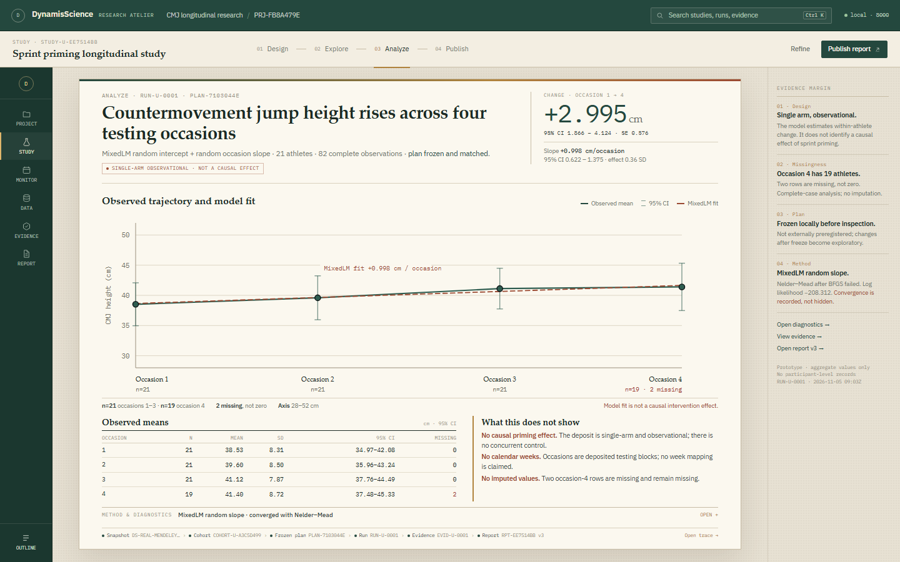

# RES-588 — Direction D: The Research Atelier

Status: **owner-requested synthesis rendered. Production untouched. Decision pending.**

> **Later addition:** after this synthesis was reviewed, the owner asked what
> the design was *for* and what to do with it. **Direction E — Fieldlab**
> ([`RES-588_UX_DIRECTION_E_FIELDLAB.md`](RES-588_UX_DIRECTION_E_FIELDLAB.md))
> adds a decision brief and an evidence ladder on top of this visual language.
> D remains the calm reading-first direction; E is the latest recommendation.

This is the fourth design direction, created after the owner asked for a mix of
A, B and C that is more insightful, intuitive, simple, non-invasive and
crafted — a “renaissance” research studio rather than a dashboard, a notebook
costume or an IDE.

Direction D is a **synthesis**, not a colour swap:

- **A contributes the activity model**: Design → Explore → Analyze → Publish,
  project context, result-first analysis and a large plot.
- **B contributes the editorial surface**: the finding is written as a
  sentence, hierarchy is carried by paper, serif type, hairlines and margin
  notes, and the report is a real document.
- **C contributes the object thread**: a compact rail of real research objects
  and one honest provenance chain, without an always-open node graph or tab
  forest.

The result is one calm page, one large result and one quiet margin.

## 1. Design principles

1. **The finding is the page.** The heading states what changed; the plaque
   states the estimate and uncertainty; the figure shows the evidence. The
   researcher does not scroll through protocol metadata to find the result.
2. **One context, four activities.** Project → study/program → activity. The
   activity arc is quiet; it is not a second navigation system.
3. **The margin is for doubt, not decoration.** Design, missingness, plan
   timing, optimiser warnings and provenance sit beside the result in a
   212 px evidence margin. They are visible but never cover the chart.
4. **Non-invasive disclosure.** Methods collapse; the outline is a flyout; the
   margin folds to a Notes control at 1280. Nothing is modal, nothing is a
   wizard, and nothing permanently steals width from the plot.
5. **Humanist, not ornamental.** Warm paper, ink green, brass, hairlines and a
   readable serif are used to create calm and hierarchy. No gradients that
   pretend to be insight, no decorative charts, no fake AI surface.

## 2. The four screens

### Analyze — the finding is the page

- Heading: **“Countermovement jump height rises across four testing
  occasions.”**
- Plaque: **+2.995 cm**, 95% CI 1.866–4.124; slope +0.998 cm/occasion
  (95% CI 0.622–1.375).
- Chart: **986 × 300 px** at 1440; **1114 × 280 px** at 1280. The chart starts
  at y=337 at 1440, versus y=3,151 in the current production study.
- The chart is preceded by a single human-readable finding, not a block
  document. Observed means and “What this does not show” follow beneath it.
- Method and diagnostics are a single collapsed disclosure at 1440. At 1280 the
  margin folds to Notes, preserving the chart.
- Provenance is a compact trace:
  Snapshot → Cohort → Frozen plan → Run → Evidence → Report.

### Design — one protocol page

- A single page, not a wizard or a card grid.
- 01 Question, 02 Data & measures, 03 Design & population, 04 Plan.
- The question is set in the largest type on the page. Data binding is one
  snapshot row. Design is a small qualified set. Readiness is a margin note.
- Primary action: `Create study`. `Save draft` is quiet. Cancel discards only
  the uncommitted page.
- The page states that nothing is persisted until Create study, one snapshot is
  bound per study, and a plan frozen after inspection is retrospective.

### Explore / Monitoring — honest lanes

- Planned weeks 5–12 are hollow brass circles on a prospective schedule lane.
- Historical occasions 1–4 are filled green squares on a separate occasion
  scale, explicitly marked “not weeks”.
- The summary is a line, not four dashboard cards: 21 monitored, 8 planned,
  4 historical, 0 new readings.
- The ledger separates planned weeks from historical readings. Missing is
  missing, not zero. No readiness or injury score is computed.
- The margin states the quality policy and provenance.

### Publish — the report is the artefact

- The report preview is a real document: question, design, methods, result,
  limitations.
- The margin holds evidence, figure, source run, frozen plan, version history,
  citations and export.
- `Export HTML` is the primary action; `Freeze version` is quiet because v3 is
  already frozen.
- The report remains pinned to its original evidence; new runs do not rewrite
  old conclusions.

## 3. How it combines A, B and C

| Source | What Direction D keeps | What it removes or reduces |
|---|---|---|
| **A — Focused Studio** | Project context; Design/Explore/Analyze/Publish; result-first stage; large plot; inspector concept | Permanent 342 px inspector becomes a 212 px margin that folds; 236 px rail becomes an 84 px thread |
| **B — Notebook** | Editorial hierarchy; finding sentence; margin notes; collapsible methods; report as document | Literal notebook cells and page metaphor; long narrative scroll; margin notes instead of a second column of cards |
| **C — Workspace** | Object rail; lineage chain; monitoring lanes; direct object access | Tabs, docking, instrument tray and multi-panel density; one canvas, one trace |

## 4. What changed from the current product

- The first screen is the **result**, not protocol metadata. The chart starts
  at **y=337** at 1440 rather than y=3,151.
- The work column is **1,060 px** wide (page) on a 1440 screen, with an 84 px
  thread and 212 px margin; the plot is 986 px wide rather than 724 px.
- The permanent 256 px Study Tree is replaced by an **84 px object thread**
  plus an on-demand outline flyout.
- The permanent 356 px Inspector is replaced by a **212 px evidence margin**
  with four notes and an on-demand method disclosure.
- The 10-block, 5-screen document is replaced by **four activity pages**.
- The mode names `Investigation / Setup / Report` become
  **Design / Explore / Analyze / Publish**.
- The single-arm real-data figure no longer uses synthetic
  `Intervention / Comparison` semantics.
- The default Mendeley Explore path uses the registered CMJ metric, not the
  incompatible 20 m sprint default that produced HTTP 422.

## 5. Non-invasive behaviour

- **Outline flyout.** The thread's bottom `Outline` control opens a 264 px
  overlay of the study's sections. It does not shift the page, and `Escape`
  closes it.
- **Evidence margin.** At 1440 it is visible as four quiet notes. At 1280 it
  folds to `Notes · 4` in the activity bar; opening it is a 300 px right-side
  drawer, not a modal. `Escape` closes it.
- **Method disclosure.** `Method & diagnostics` is a native `
` bar.
  Opening it reveals the formula, variance components, assumptions and the
  optimiser warning. It does not cover the chart.
- **No wizard.** Study creation is a single page. The question, data, design
  and plan are all visible together.
- **No decorative dashboards.** Counts are presented as a summary line, not a
  KPI grid.
- **No hidden science.** Every number on the page has a source: the run, the
  plan, the cohort, the snapshot and the DOI.

## 6. Insight and scientific honesty

The design makes the result easier to read **without** making it easier to
overclaim:

- The heading is a descriptive finding, not a causal claim.
- A visible guard chip says “Single-arm observational · not a causal effect.”
- The plaque separates the estimate, the confidence interval, the slope and the
  effect size.
- “What this does not show” names the absent control arm, the non-calendar
  occasions and the missing values.
- The margin repeats the missingness, plan timing and optimiser warning.
- The report's limitations section is part of the document, not a tooltip.

This is the “insightful” part of the brief: the page should help a scientist
understand the result and its limits in one read, not merely look modern.

## 7. Accessibility and responsive treatment

- Native links, buttons, `
` and form controls.
- `Escape` closes the outline; the toggle exposes `aria-expanded`.
- The chart has a text summary in the plaque and a descriptive `aria-label`.
- The activity arc is a labelled navigation landmark; the thread is a labelled
  complementary navigation.
- At 1280 the thread becomes a 64 px icon rail, the margin folds to Notes, and
  the chart remains **1114 × 280 px**. No horizontal overflow was measured.
- A production implementation must add a skip link, roving focus for the
  activity arc and outline, and a contrast audit of the light paper palette.

## 8. Implementation cost and risk

**Medium**, close to Direction A.

Reusable with little change:

- `AnalysisBlocks`, `DiagnosticsBlock`, `EvidenceBlocks`, `FigureBlock`
- `Inspector` content (recomposed into the margin / disclosure)
- `ReportDocument`
- Existing charts, run/evidence/report APIs, SQLite research store, frozen
  plans, lineage and export.

New work:

- A light, paper-based shell and responsive margin.
- Activity routing and composition of four pages from existing blocks.
- The 84 px thread and outline flyout.
- A visual system that must pass contrast and print/export checks.

No backend, schema, dataset, analysis or persistence change is required. The
main risk is not technical: a light theme and editorial typography are a
product taste decision, and the margin must remain genuinely useful rather than
becoming decoration. At 1280 the method disclosure folds into the Notes drawer
so the plot, observed means, limitations and trace fit the first screen.

## 9. Comparison with A, B and C

| Dimension | A Studio | B Notebook | C Workspace | **D Atelier** |
|---|---|---|---|---|
| Plot at 1440 | 784 × 405 | 834 × 310 | 594 × 338 | **986 × 300** |
| Plot at 1280 | 832 × 307 | 994 × 270 | 732 × 360 | **1114 × 280** |
| First-screen result | Yes | Yes | Yes | **Yes, plus written finding** |
| Permanent chrome | 236 + 342 | 226 + 268 | 258 + 292 | **84 + 212** |
| Modes | 4 | narrative | tabs | **4 quiet modes** |
| Method inspection | inspector | margin + disclosure | tray | **margin + disclosure** |
| Monitoring | good | weak | excellent | **strong two-lane timeline** |
| Report | good | excellent | good | **strong document preview** |
| New-user clarity | high | high (reading) | medium | **highest** |
| Power-user density | high | medium | highest | **medium–high** |
| Cost | medium | high | medium–high | **medium** |
| Risk | medium | high | medium–high | **medium** |

## 10. Recommendation

**Direction D — The Research Atelier is the recommended design.**

It answers the owner's brief more directly than any single direction:

- It is **insightful** because the finding is the page and the limitations are
  in the margin, not in a footnote.
- It is **intuitive** because the four activities match the research workflow
  and the project/study/program nouns are separated.
- It is **simple** because there are four activities, six thread objects and
  one large plot; methods and outline appear only when requested.
- It is **non-invasive** because there is no permanent inspector, no modal, no
  wizard and no tab forest.
- It is **renaissance** in the humanist sense: paper, ink, serif, brass and
  measured hairlines, used to make scientific reading calm and deliberate.

It also keeps the strongest engineering property of A: the science surfaces can
be recomposed from the existing codebase, with no speculative backend work.

This is a target state, not a claim of flawlessness. Product-owner visual
approval remains the gate; the design has not been applied to production.

## 11. Artifacts

| Artifact | Path |
|---|---|
| Analyze, 1440 | `docs/design/res588-ux/screens/d-analyze-1440x900.png` |
| Design, 1440 | `docs/design/res588-ux/screens/d-design-1440x900.png` |
| Monitoring, 1440 | `docs/design/res588-ux/screens/d-monitoring-1440x900.png` |
| Publish, 1440 | `docs/design/res588-ux/screens/d-publish-1440x900.png` |
| Analyze, 1280 | `docs/design/res588-ux/screens/d-analyze-1280x800.png` |
| Notes drawer, 1280 | `docs/design/res588-ux/screens/d-analyze-1280x800-notes.png` |
| Gallery | `docs/design/res588-ux/compare/atelier.html` |
| Prototype | `docs/design/res588-ux/prototypes/d/` |
| Render receipt | `docs/design/res588-ux/screens/render-receipt-d.json` |

## 12. Decision

The owner requested this synthesis. The next decision is whether to accept
**D** as the production direction, or to return to A, B or C.

No production UI, data, run, evidence, report or backend contract has been
changed. No push has been made.
