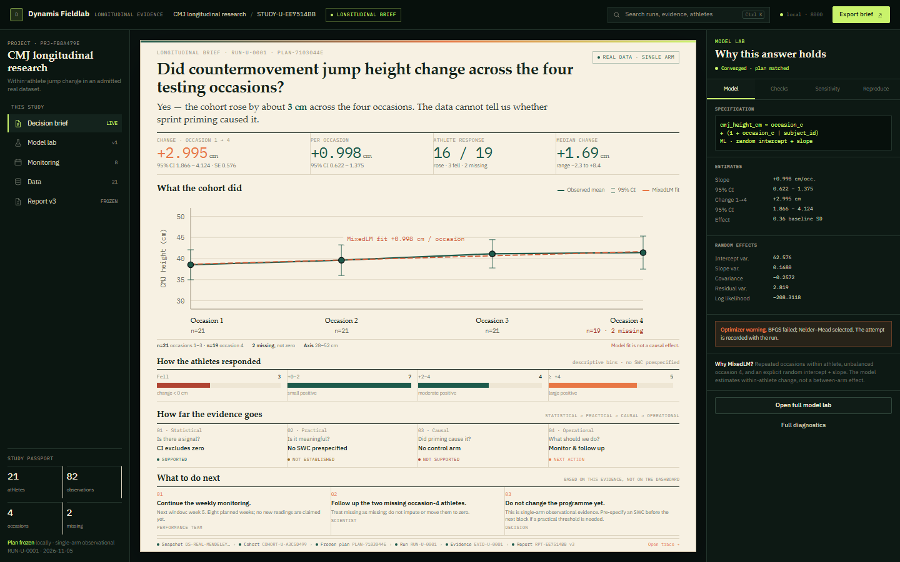
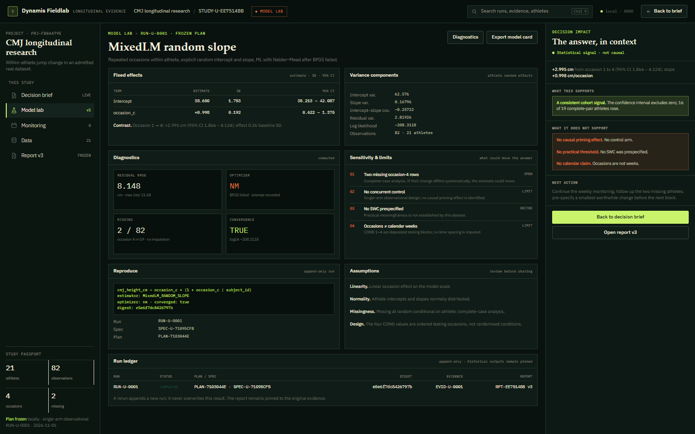

# RES-588 — Direction E: Fieldlab

Status: **owner-requested impact design rendered. Production untouched. Decision pending.**

This direction answers the owner’s question directly:

> “Wow, cool — but what is this for? What do I do with it?”

Fieldlab is not another beautiful analysis page. It is a **longitudinal decision
instrument** with two surfaces:

1. **Decision Brief** — what changed, how sure we are, whether it matters, who
   responded and what to do next.
2. **Model Lab** — the model, diagnostics, sensitivity, assumptions and
   reproducibility needed to defend the answer.

The brief is the product. The lab is one click away.

## 1. The five questions the brief answers

| Question | Answer on the page |
|---|---|
| **What changed?** | +2.995 cm from occasion 1 to 4; +0.998 cm per occasion. |
| **How sure?** | 95% CI 1.866–4.124; converged MixedLM; plan frozen and matched. |
| **Does it matter?** | **Not established.** No smallest worthwhile change was prespecified. |
| **Who responded?** | 16 of 19 complete-pair athletes rose; 3 fell; 2 missing. Median +1.69 cm; range −2.3 to +8.4. |
| **What now?** | Continue weeks 5–12; follow up two missing athletes; do not change the programme yet. |

This is the difference between a chart and a decision.

## 2. The evidence ladder

The centre of the brief is not the plot. It is the four-step ladder from
statistical evidence to operational action:

1. **Statistical** — CI excludes zero → **Supported**.
2. **Practical** — no SWC prespecified → **Not established**.
3. **Causal** — no control arm → **Not supported**.
4. **Operational** — monitor and follow up → **Next action**.

The ladder makes it impossible to jump from “the CI excludes zero” to “the
training block worked”. It also prevents the opposite failure: dismissing a
real signal because the design cannot support a causal claim.

## 3. Sports-science detail, not generic statistics

- **Athlete response is shown, not hidden.** 16 of 19 complete-pair athletes
  rose, 3 fell, 2 are missing. The bins are descriptive; no SWC is invented.
- **Practical meaning is explicitly unresolved.** Effect size is 0.36 baseline
  SD, but the brief does not label the change meaningful or trivial.
- **Missingness is part of the result.** Two occasion-4 rows are missing, not
  zero; the response count uses 19 complete pairs.
- **Monitoring is the next action.** Weeks 5–12 remain prospective; no new
  readings are claimed.
- **The decision is bounded.** The brief says what to do and what not to do:
  continue measurement, follow up missing athletes, do not change the programme
  on single-arm evidence.

## 4. The statistics-software layer

The right-hand **Model Lab** borrows the working grammar of serious longitudinal
software without importing a dependency or a generic console:

- explicit model formula;
- fixed-effect coefficient table with SE and 95% CI;
- random-effect variance components and covariance;
- convergence, optimizer and log-likelihood;
- residual, missingness and assumption checks;
- sensitivity to missingness, control, SWC and time coding;
- reproduce block with run, spec, plan, environment and digest;
- append-only run ledger and pinned report.

The full `Model lab` page expands these into a dark, dense statistical surface:
fixed effects, variance components, diagnostics, sensitivity, assumptions,
reproduce and run ledger. The **Decision impact** panel keeps the sports-science
interpretation beside the statistics.

This is the “mix” the owner asked for: RStudio/JASP/jamovi/Stata/Prism-style
method transparency, with a sports-science decision layer in front.

## 5. How it relates to A, B, C and D

| | D — Research Atelier | **E — Fieldlab** |
|---|---|---|
| Primary question | “What does the study say?” | **“What do I do with this?”** |
| Landing surface | Editorial analysis page | **Decision brief** |
| Result | Finding + chart + margin | **Five questions + evidence ladder + actions** |
| Statistics | Method disclosure / drawer | **Dedicated Model Lab** |
| Sports-science layer | Limitations and monitoring | **Athlete response, SWC, operational action** |
| Visual language | Calm paper reading room | **Paper brief + dark instrument lab** |
| Risk | Too quiet, still reading-first | **Dense; must be copy-reviewed** |

D was the right aesthetic and the right reading page. E adds the missing job:
a decision and a next action, with the statistical defence one click away.

## 6. Interaction and accessibility

- Brief and lab are two real pages; the left rail keeps project/study context.
- The `Model lab` rail item opens the full lab. At 1280 the lab becomes a
  right-side drawer via `Model lab` in the top bar; `Escape` closes it.
- Model Lab tabs (`Model / Checks / Sensitivity / Reproduce`) are native buttons
  with `aria-selected`; a production implementation should add arrow-key tab
  semantics.
- The chart has a text summary in the stat strip and a descriptive `aria-label`.
- The brief uses native buttons/links and a visible focus ring.
- The paper/dark split needs a contrast audit in production; the current
  prototype has no horizontal overflow and 0 console errors.

## 7. Measured result

- Decision Brief: **836 × 230 px** plot at 1440; **1138 × 220 px** at 1280.
- The brief fits the main viewport exactly: `mainScrollH = mainClientH = 852`
  at 1440 and `752` at 1280.
- Right lab: 310 px at 1440; hidden behind a drawer at 1280.
- 0 console errors; 0 horizontal overflow.
- The plot is deliberately smaller than D’s because the page now has to fit the
  evidence ladder and three actions above the fold. The trade is intentional:
  the decision, not the chart, is the hero.

## 8. Implementation cost and risk

**Medium**, similar to D.

Reusable:

- existing MixedLM result and diagnostics;
- run, evidence, report and provenance APIs;
- `FigureBlock`/chart helpers;
- frozen plan, cohort and persistence;
- report export.

New:

- Brief composition and copy;
- Evidence ladder logic and copy;
- Lab page / lab drawer;
- response-distribution aggregation from the admitted snapshot's complete pairs;
- light paper + dark lab visual system and responsive treatment.

No backend, schema, dataset, analysis or persistence change is required.

Risks:

- The brief is dense. Typography and copy must be usability-tested; if the
  actions are not read, the design fails.
- “Does it matter?” must not become a pseudo-SWC. The page must continue to say
  “not established” unless a threshold was prespecified.
- The response counts are descriptive, not model-adjusted; the page says so.
- The paper/dark split is a strong taste decision and needs owner approval.

## 9. Recommendation

**Direction E — Fieldlab is the recommended design.**

It is the first direction that answers the owner’s actual question. It makes the
scientific result actionable without overclaiming, and it keeps the statistical
software depth available for inspection rather than turning it into decoration.

It preserves every scientific and persistence contract, adds no external
service, and can be implemented by recomposing existing surfaces.

## 10. Artifacts

| Artifact | Path |
|---|---|
| Decision Brief, 1440 | `docs/design/res588-ux/screens/e-brief-1440x900.png` |
| Decision Brief, 1280 | `docs/design/res588-ux/screens/e-brief-1280x800.png` |
| Model Lab, 1440 | `docs/design/res588-ux/screens/e-lab-1440x900.png` |
| Model Lab, 1280 | `docs/design/res588-ux/screens/e-lab-1280x800.png` |
| Gallery | `docs/design/res588-ux/compare/fieldlab.html` |
| Prototype | `docs/design/res588-ux/prototypes/e/` |
| Render receipt | `docs/design/res588-ux/screens/render-receipt-e.json` |

## 11. Decision

Accept **E — Fieldlab** as the production direction, or choose another direction.
No production UI, data, run, evidence, report or backend contract has been
modified. No push has been made.
