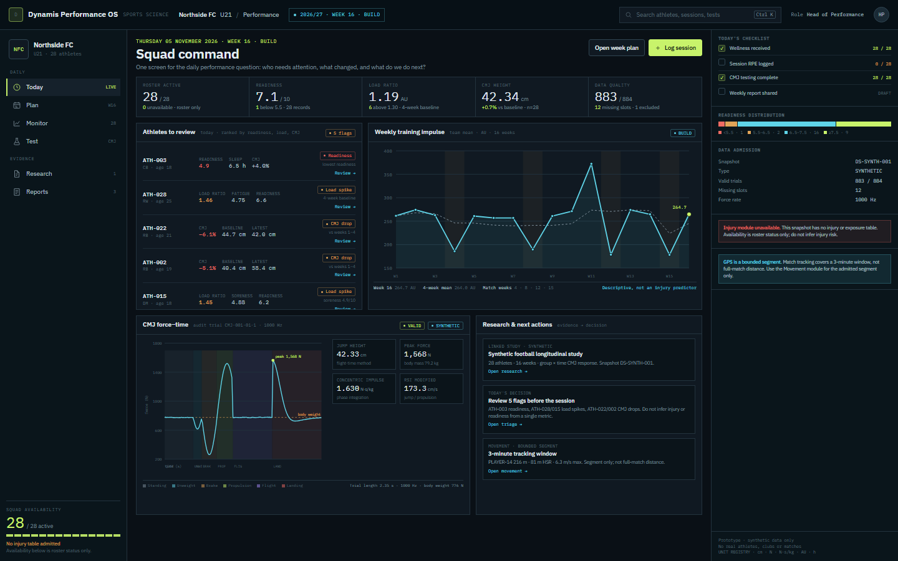

# Sports Science Design Pattern — Dynamis Performance OS

Status: **research and pattern definition complete. Production untouched.**
Date: 2026-11-05 · Native Windows / PowerShell · local synthetic fixture
`DS-SYNTH-001` (28 football athletes, 16 weeks).

This document answers the question the previous design directions did not:

> Does it support what a sports scientist actually needs and uses daily — and
> does it look, read and behave like sports science?

The short answer: a beautiful research brief alone does not. Sports science is
a **daily operating loop** around load, readiness, availability, testing,
evidence and decisions. This pattern defines that loop and the modules,
components, units and models required to support it.

It is implemented as a visual exemplar in:

- `prototypes/f/command.html` — Squad Command, the daily screen.
- `prototypes/f/atlas.html` — component, chart and unit atlas.
- `screens/f-command-1440x900.png`, `screens/f-command-1280x800.png`.
- `screens/f-atlas-1440x900.png`.

## 1. The practice model: what sports science actually does

Sports science is not one workflow. It is four nested cadences.

### Daily loop

1. Check who is available and who is flagged.
2. Review wellness/readiness and the previous session load.
3. Adjust the session or the individual.
4. Record actual load, RPE and attendance.
5. Escalate only the exceptions.

### Weekly loop

1. Plan the microcycle.
2. Compare planned vs actual load and high-speed exposure.
3. Review squad and individual trends.
4. Run or review testing.
5. Send a coach/medical summary.
6. Update the next week.

### Block / season loop

1. Define the block and its performance question.
2. Benchmark the squad and individuals.
3. Monitor response and availability.
4. Test at the planned window.
5. Adjust the block.
6. Preserve the evidence for the season review.

### Research loop

1. Ask a question.
2. Bind a snapshot and cohort.
3. Freeze an analysis plan.
4. Run a qualified model.
5. Promote evidence.
6. Publish a report that states uncertainty and limitations.

A sports science platform is credible only when all four loops share the same
athlete, session, test, metric, unit and provenance model.

## 2. Product architecture: six workspaces, one athlete model

| Workspace | Primary question | Default modules | Primary action |
|---|---|---|---|
| **Today** | Who needs attention now? | Squad pulse, attention list, availability, data quality, today's checklist | Review / log session |
| **Plan** | What should we do this week/block? | Microcycle, session builder, load targets, testing calendar, groups | Publish week |
| **Monitor** | What is changing over time? | Load, wellness, readiness, CMJ, GPS, availability, athlete 360 | Open athlete / adjust |
| **Test** | What can this athlete do, and how reliable is it? | Testing battery, force lab, sprint, strength, GPS, reliability | Run / review test |
| **Research** | What does the evidence support? | Studies, cohorts, plans, runs, evidence, decision brief, model lab | Freeze / run / publish |
| **Report** | What does each audience need to know? | Athlete, coach, medical, board templates; version history | Share / export |

The workspaces are not separate products. They share one context:

**Club → Squad → Season → Block → Microcycle → Session → Athlete → Test → Metric.**

The previous design directions used generic `Design / Explore / Analyze /
Publish`. That is a research vocabulary. Sports science needs the **daily,
weekly and seasonal vocabulary above** first, with research as a first-class
workspace rather than the whole product.

## 3. Module catalogue

Each module has one primary question. If a module cannot state its question, it
is a dashboard ornament.

| # | Module | Question | Core components | Canonical units | Required data | Empty / unavailable state |
|---:|---|---|---|---|---|---|
| 1 | **Squad Command** | Who needs attention today? | Pulse strip, attention rows, flags, availability, checklist | mixed; every value carries a unit | roster, wellness, load, tests | “No roster admitted” |
| 2 | **Athlete 360** | What is this athlete’s status and trajectory? | Header, status, readiness, load, CMJ, GPS, testing, notes | cm, N, N/kg, AU, m/s, % | athlete, sessions, tests, wellness | “No longitudinal record” |
| 3 | **Wellness & Readiness** | Is the athlete ready for the planned load? | Sleep, soreness, fatigue, stress, readiness, trend | h, 0–10, 1–7 | daily/weekly questionnaire | “Questionnaire not returned” |
| 4 | **Training Load** | What load did the athlete actually absorb? | sRPE AU, external load AU, duration, HSR, acceleration, match minutes | AU, min, m, m/s, m/s² | session logs, GPS, RPE | “No session loads” |
| 5 | **Session Planner** | What is planned, and what was done? | Session blocks, groups, targets, planned vs actual, attendance | AU, min, reps, %1RM, m | plan, roster, drills | “No plan published” |
| 6 | **Testing Battery** | Did the athlete change on a valid test? | Test order, protocol, device, calibration, trials, quality, result | cm, s, N, N/kg, W/kg | test protocol + trial data | “No testing window” |
| 7 | **Force Lab** | What do the force–time and phase metrics show? | Force curve, phase shading, peak, impulse, RSI, asymmetry, trial quality | N, N·s/kg, cm, s, cm/s | 1000 Hz force trace | “No force trace admitted” |
| 8 | **Movement / GPS** | How did the athlete move? | Distance, speed zones, HSR, sprints, accel/decel, heatmap | m, m/s, m/s², AU | 10 Hz tracking or GPS | “Segment only / not full match” |
| 9 | **Availability & Injury** | Who is available, and what is the injury burden? | Status, injury log, location, severity, exposure, incidence | days, per 1000 h, % | injury + exposure table | “No injury table admitted” |
| 10 | **Return to Play** | Has the athlete met the criteria? | Criteria checklist, LSI, hop tests, force asymmetry, load progression, clearance | %, N, cm, days | injury + test + medical | “RTP pathway not configured” |
| 11 | **Periodization** | Does the block plan match the season? | Phases, microcycles, planned vs actual, testing windows, competition | weeks, AU, min | calendar + plan | “No season plan” |
| 12 | **Alerts & Triage** | Which exceptions need a human? | Rule, threshold, severity, evidence, owner, status, review | rule-specific | any monitored metric | “No alert rules” |
| 13 | **Data Quality** | Can we trust the data? | Valid/excluded/missing, device, calibration, sync, duplicates, provenance | counts, %, ms | manifest + device metadata | “No manifest” |
| 14 | **Research & Evidence** | What does the study support? | Study, cohort, plan, run, evidence, brief, lab, sensitivity | model-specific | admitted snapshot | “No study bound” |
| 15 | **Reports** | What does this audience need? | Athlete/coach/medical/board templates, evidence, version, export | mixed | all of the above | “Report not composed” |
| 16 | **Settings / Units** | What do these numbers mean? | Unit registry, thresholds, devices, protocols, roles, consent | all canonical | configuration | “Defaults only” |

### Modules the current product already partially supports

- Force/CMJ viewer and metrics.
- Match/pose/GPS segment viewer.
- Data admission, checksums, library, metric/protocol registry.
- Research studies, cohorts, plans, runs, evidence, reports.
- Reliability and MixedLM.

### Modules that require new composition (data already present)

- Squad Command (roster, wellness, load, CMJ).
- Athlete 360 (longitudinal synthetic/real data).
- Wellness and load monitoring.
- Testing battery and periodization.
- Unit registry and role-aware reports.

### Modules that require new data contracts

- Injury surveillance and exposure.
- Return to play.
- Session planner / attendance.
- Roster consent and availability provenance.

These must appear as **honest empty states**, not fabricated data. The synthetic
fixture contains no injury table, so the command dashboard says
“Injury module unavailable — no injury or exposure table.”

## 4. Domain model

| Entity | Key fields | Relationships |
|---|---|---|
| **Club** | id, name, season, timezone | has squads |
| **Squad** | id, name, level, roster | has athletes, staff, season |
| **Athlete** | id, display id, position, birth year, body mass, height, consent, status | belongs to squad; has sessions, tests, injuries |
| **Season** | id, label, start/end, competition calendar | contains blocks |
| **Block** | id, phase (build/match/taper), start/end, objectives | contains microcycles |
| **Microcycle** | id, week, planned load, focus | contains sessions, testing window |
| **Session** | id, date, type, planned load, actual load, duration, RPE, attendance | belongs to microcycle; has athlete loads |
| **Test** | id, protocol, device, date, order, calibration, quality | has trials; belongs to athlete |
| **Trial** | id, test id, trial number, raw signal, quality state, exclusion reason | has metrics |
| **Metric** | canonical id, label, unit, definition, aggregation, direction | used by tests/sessions |
| **Unit** | canonical symbol, quantity, dimension, display precision | attached to metric/value |
| **Device** | id, type, sample rate, calibration, serial | produces trials/signals |
| **Injury** | id, athlete, location, type, mechanism, severity, exposure, status | has RTP stages |
| **Exposure** | athlete, session/match, minutes, hours | denominator for injury rates |
| **Alert** | rule, severity, evidence, owner, status, reviewed_at | references metrics/athletes |
| **Report** | audience, period, evidence, version, frozen_at | references runs/evidence |
| **Study** | question, design, cohort, plan, runs, evidence | uses snapshot |
| **Cohort** | rules, resolved subjects, missingness, version | bound to snapshot |
| **Snapshot** | id, source, checksum, tables, rows, rights | immutable |
| **Evidence** | run, result digest, diagnostics, limitations | cited by report |

### Non-negotiable model rules

- One athlete identity across squad, load, wellness, testing, injury and research.
- One metric definition and unit per quantity; no “jump height” in two units.
- One snapshot/source per study; no duplicated source of truth.
- Planned and actual are separate fields.
- Missing, excluded, estimated and modelled are distinct states.
- Every value has a timestamp, source and sample size.
- Every chart has a reference window (baseline, rolling, cohort or season).

## 5. Analytical model catalogue

| Model / method | When to use | Data shape | Outputs | Units | Guardrail |
|---|---|---|---|---|---|
| Descriptive summary | Baseline understanding | Any numeric | n, mean, SD, median, range, CI | metric unit | No inference |
| Reliability ICC(3,1) | Repeated trials | Balanced trials per athlete | ICC, TE, CV, CI | unitless, unit, % | Balanced design; no causal claim |
| Bland–Altman | Agreement between devices/methods | Paired measurements | Bias, limits of agreement | metric unit | Not a reliability coefficient |
| Individual change vs TE | Did this athlete change? | Baseline/post pairs | Change, TE, ratio | metric unit | TE must be from the same protocol |
| MixedLM random slope | Longitudinal change | Repeated measures, ≥2 time points | Fixed slope, random effects, CI, diagnostics | metric unit per time | Model assumptions; design limits |
| Group × time interaction | Between-arm difference in change | ≥2 arms, repeated measures | Difference-in-change, CI | metric unit | Needs actual allocation; no invented arms |
| GEE / clustered robust | Population-average repeated measures | Clustered observations | Coefficients, robust SE | metric unit | Different estimand from MixedLM |
| ANCOVA | Post-test adjusted for baseline | Baseline + post, groups | Adjusted mean difference | metric unit | Not for repeated time series |
| SPC / control chart | Individual monitoring over time | Time-ordered single-athlete data | Center line, control limits, signals | metric unit | Requires stable baseline; not diagnosis |
| Poisson / negative binomial | Injury incidence | Injuries + exposure | Rate per 1000 h, CI | per 1000 h | Exposure denominator required |
| Survival / time-to-event | Return to play / injury-free time | Time + event/censor | Hazard/curve | days, hazard ratio | Censoring assumptions |
| Power / sample size | Planning a study | Effect, SD, alpha, power | n, detectable effect | unit / SD | Prospective only |
| Sensitivity analysis | Missingness / design assumptions | Multiple scenarios | Range of estimates | metric unit | Must be labelled exploratory |
| Bayesian hierarchical | Shrinkage / uncertainty | Repeated measures | Posterior, credible interval | metric unit | **Not implemented in MVP**; do not fake |
| ML / PIML | Prediction / physics-informed | Large labelled data | Prediction, uncertainty | metric unit | **Unavailable**; no fake AI surface |

The current registry already includes MixedLM, ICC/TE/CV, individual change and a
prototype training-response model. The design pattern adds the missing
sports-science methods without claiming they are implemented.

## 6. Component catalogue

### Status atoms

- Availability: **Available / Modified / Rehab / Unavailable / No data**.
- Data quality: **Valid / Excluded / Missing / Estimated / Modelled**.
- Evidence: **Direct / Derived / Modelled / Inferred**.
- Plan: **Planned / Actual / Adjusted / Not recorded**.
- Confidence: **n**, CI, reference window, “as of” timestamp.
- Unit chip: every value has one; no naked numbers.
- Position chip: GK/RB/CB/LB/DM/CM/AM/RW/LW/ST.
- Phase chip: Build / Match / Taper / Recovery / Off-season.
- Severity: **info / attention / action** with text, not colour alone.

### Cards

1. **Athlete status card** — identity, position, availability, readiness, one flag, review action.
2. **Metric card** — value, unit, reference, delta, sparkline, n, timestamp.
3. **Session card** — planned vs actual load, RPE, attendance, duration, phase.
4. **Test card** — protocol, device, trial quality, result, unit, comparison.
5. **Alert card** — rule, evidence, owner, status, “review” action.
6. **Study card** — question, snapshot, cohort, plan, status, evidence.
7. **Data-quality card** — valid/excluded/missing, cause, source.
8. **Empty state** — what is missing, why it matters, how to admit it.

### Charts

1. Individual longitudinal line with baseline/reference band and missing gaps.
2. Small-multiple squad trajectories.
3. Squad availability/readiness heatmap.
4. Periodization bars: planned vs actual.
5. Rolling load / load-ratio band, labelled descriptive.
6. Wellness stacked bars and readiness sparkline.
7. CMJ force–time curve with phase shading.
8. CMJ phase/composite bars.
9. Sprint velocity curve and split times.
10. GPS speed-zone distribution and position heatmap.
11. Reliability ICC/TE forest or Bland–Altman.
12. Injury incidence per 1000 h with CI and exposure.
13. Percentile/dot plot against cohort or position.
14. Forest plot for effects and contrasts.
15. Control chart / SPC for individual monitoring.
16. Provenance/lineage chain.

### Tables

- Roster and availability.
- Session load ledger (planned vs actual).
- Testing results (protocol, trial, quality, unit).
- Injury log with exposure.
- Data-quality/import log.
- Run/evidence ledger.
- Unit registry.

### Controls

- Time range: session / day / week / microcycle / block / season.
- Cohort: squad / position / individual / group.
- Reference: baseline / rolling 4-week / season / cohort / position.
- Planned vs actual toggle.
- Missing-data policy (show / exclude / sensitivity).
- Role/audience.
- Unit system (display only).
- **As-of timestamp** and source.

## 7. Chart selection matrix

| Question | Chart | Required unit | Avoid |
|---|---|---|---|
| Is this athlete changing? | Individual line + reference band | metric unit, time axis | radar chart; dual axes |
| Is the squad ready? | Heatmap + distribution | 0–10 / status | single average hiding outliers |
| Is load changing? | Planned vs actual bars + rolling line | AU, min | ACWR as injury prediction |
| Did the test change? | Dot/CI plot with baseline | cm, N, s | bar chart with truncated axis |
| Is the test reliable? | ICC/TE forest or Bland–Altman | ICC, TE, % | correlation as agreement |
| Is the athlete asymmetrical? | Side-to-side dot/bar | %, N, cm | unlabelled percentage |
| How did they move? | Speed-zone bars + heatmap | m, m/s | total distance alone |
| Is injury burden high? | Rate per 1000 h with CI | per 1000 h | raw injury counts |
| Is this effect real? | Forest plot with CI | metric unit | p-value-only table |
| Is this individual unusual? | Percentile/dot plot | percentile, unit | z-score without reference |
| Is the process stable? | Control chart | metric unit | threshold traffic light only |

## 8. Unit registry

| Quantity | Canonical unit | Symbol | Example | Display rule |
|---|---|---|---|---|
| Jump height | centimetre | cm | 42.34 cm | 2 decimals |
| Distance | metre | m | 216 m | integer |
| Sprint time | second | s | 3.42 s | 2 decimals |
| Phase duration | second | s | 0.222 s | 3 decimals |
| Force | newton | N | 1,568 N | integer |
| Relative force | newton per kg | N·kg⁻¹ | 32.4 N·kg⁻¹ | 1 decimal |
| Impulse | newton-second per kg | N·s·kg⁻¹ | 1.630 N·s·kg⁻¹ | 3 decimals |
| Power | watt per kg | W·kg⁻¹ | 52.1 W·kg⁻¹ | 1 decimal |
| Velocity | metre per second | m·s⁻¹ | 6.30 m·s⁻¹ | 2 decimals |
| Acceleration | metre per second squared | m·s⁻² | 3.20 m·s⁻² | 2 decimals |
| External load | arbitrary unit | AU | 378.2 AU | 1 decimal |
| Session RPE | 0–10 scale | RPE | 7.0 | 1 decimal |
| sRPE load | arbitrary unit | AU | 420 AU | integer |
| Wellness/readiness | 0–10 scale | 0–10 | 7.1/10 | 1 decimal |
| Sleep | hour | h | 7.14 h | 1 decimal |
| Body mass | kilogram | kg | 79.15 kg | 2 decimals |
| Body weight | newton | N | 776 N | integer |
| Asymmetry / LSI | percent | % | 94.2% | 1 decimal |
| ICC | unitless | ICC | 0.95 | 2–3 decimals |
| CV | percent | % | 4.21% | 2 decimals |
| Typical error | metric unit | TE | 49.7 N | same as metric |
| SWC | metric unit | SWC | 12.4 N | same as metric |
| Effect size | standard deviation | SD | 0.36 SD | 2 decimals |
| z-score | standard deviation | z | −1.2 | 1 decimal |
| Percentile | percent | percentile | 78th | integer |
| Injury incidence | per 1000 hours | per 1000 h | 2.4/1000 h | 1 decimal |
| Exposure | hour | h | 18.5 h | 1 decimal |
| Availability | percent | % | 96.4% | 1 decimal |
| Match minutes | minute | min | 90 min | integer |
| Heart-rate variability | millisecond | ms | 42 ms | integer |

**Storage rule:** store canonical values (SI or declared canonical) and display
with the unit; never store a rounded display value as truth.

## 9. Design rules

1. **One module, one question.** If a card cannot state its question, remove it.
2. **No value without a unit.** Unit chips are mandatory.
3. **No chart without a reference.** Baseline, rolling window, cohort or season.
4. **No sample without n.** Every aggregate shows n and missing count.
5. **Missing is a visible state.** Never zero, never silently interpolated.
6. **Planned and actual are separate.** Do not merge them into one bar.
7. **No traffic light without a threshold.** State who set it and when.
8. **No ACWR as injury prediction.** Show load ratio as descriptive context.
9. **No causal language from observational data.** “Associated with” is not “caused by”.
10. **No hidden imputation or model substitution.** Record the method.
11. **No red/green alone.** Pair with text and icon.
12. **One timestamp and source per metric.**
13. **Use the athlete’s own baseline before the cohort.**
14. **Respect role and privacy.** Medical data is not a coach dashboard default.
15. **No dashboard without a next action.** Every exception has an owner.

## 10. Roles and permissions

| Role | Default workspace | Sees | Does not see by default |
|---|---|---|---|
| Head of Performance | Today / Plan | Squad load, readiness, availability, reports | Clinical notes |
| S&C Coach | Today / Plan | Session load, readiness, individual response | Medical diagnosis |
| Sports Scientist | Monitor / Test / Research | Full testing, models, diagnostics, evidence | Clinical notes |
| Physio / Medical | Availability / RTP | Injury, rehab, RTP criteria | Full research models |
| Analyst | Monitor / Test | GPS, match, tests | Medical notes |
| Athlete | My status | Own readiness, load, testing schedule | Squad/medical data |
| Director | Report | Aggregate availability, load, risk, outcomes | Individual clinical data |

## 11. Current product gap analysis

### Already present

- Data admission, checksums, rights/privacy, Library.
- Metric/protocol registry.
- CMJ force/phase metrics and force viewer.
- Match/pose/GPS segment viewer.
- Research projects, studies, cohorts, plans, runs, evidence, reports.
- MixedLM, ICC/TE/CV, individual change.
- Local persistence and provenance.

### Missing for the daily sports-science product

**P0 — daily credibility**
- Squad Command / Today.
- Athlete 360.
- Unit registry and status language.
- Data-quality/empty-state surfaces.
- Role-aware navigation.
- Honest separation of roster status from injury/availability.

**P1 — weekly practice**
- Wellness/readiness module.
- Training-load module with planned vs actual.
- Testing battery and periodization.
- Movement/GPS module.
- Report templates for coach/medical/board.

**P2 — high-value specialist**
- Injury surveillance/exposure.
- Return-to-play criteria.
- Alert rules with owners and review.
- Session planner/attendance.
- Power/sample-size and sensitivity workflows.

### Data honesty

The current synthetic fixture has roster, wellness, load, CMJ, force traces and
a bounded GPS segment. It has **no injury/exposure table**. The pattern therefore
shows an explicit empty state rather than inventing injury risk. Real-data
workflows (Mendeley/MoveSmart) remain research-only and must not be mixed into
the synthetic squad dashboard.

## 12. Implementation sequence

1. **Foundations**: unit registry, status atoms, data-quality states, chart primitives.
2. **Today**: Squad Command using roster/wellness/load/CMJ.
3. **Athlete 360**: one athlete, longitudinal baseline + tests + availability.
4. **Testing**: battery + force lab + reliability.
5. **Monitor**: load/wellness trends and periodization.
6. **Research**: connect study/evidence/decision brief and model lab.
7. **Reports**: audience templates.
8. **Injury/RTP**: only after an injury/exposure contract is admitted.

No backend rewrite is required for P0/P1 if the existing snapshot and research
store are reused. New contracts are needed for injury, RTP and session planning.

## 13. What “sports science coded” means here

It means the product speaks the language of the practice:

- **Positions**: GK, RB, CB, LB, DM, CM, AM, RW, LW, ST.
- **Units**: cm, N, N·kg⁻¹, N·s·kg⁻¹, AU, m·s⁻¹, %, h, per 1000 h.
- **Cadence**: today, microcycle, block, season.
- **Load**: sRPE, external load, HSR, acceleration, match minutes.
- **Readiness**: sleep, soreness, fatigue, readiness.
- **Testing**: protocol, device, calibration, trial, quality, missingness.
- **Availability**: roster status, injury, exposure, RTP.
- **Evidence**: cohort, plan, run, uncertainty, limitations.

It does **not** mean adding a radar chart and a red/amber/green tile.

## 14. Practice references

This pattern is a product design synthesis, not a systematic review. The
practice assumptions are drawn from established sports-science literature and
common performance-platform patterns, including:

- Session-RPE and internal load (Foster et al., 2001).
- Wellness/readiness questionnaires (Hooper & Mackinnon, 1995).
- Training-injury prevention and load management (Gabbett, 2016).
- The acute:chronic workload ratio critique (Impellizzeri et al., 2020).
- Injury surveillance and exposure denominators (Bahr et al., 2020; OSTRC,
  Clarsen et al., 2013).
- Return-to-play consensus (Ardern et al., 2016).
- Reliability, typical error and ICC (Shrout & Fleiss, 1979; Hopkins, 2000;
  Bland & Altman, 1986).
- GPS/load metrics in team sport (Cummins et al., 2013).
- Countermovement jump testing and force-plate metrics (Gathercole et al.,
  2015).

The design deliberately does **not** treat ACWR as an injury predictor, does not
invent SWC, and does not present observational associations as causal.

## 15. Visual exemplar

- Squad Command: `screens/f-command-1440x900.png` and `1280x800`.
  - 28 active, readiness 7.1/10, load ratio 1.19, CMJ 42.34 cm, data quality
    883/884.
  - Five attention flags, 16-week load, CMJ force–time, research link,
    data-admission states.
- Component atlas: `screens/f-atlas-1440x900.png`.
  - Status language, units, cards, chart specimens, tables, module map.

The exemplar uses **synthetic data only**. It is a pattern demonstration, not a
claim about a real club or athlete.

## 16. Decision

This is the design pattern to implement if the product is to be a sports
science platform rather than a research brief with a dashboard skin.

The next step is to choose the scope:

- **P0 + P1** — daily command, athlete profile, load/wellness, testing,
  monitoring, reports. This is the minimum coherent sports-science product.
- **P2** — injury/RTP/alerts/session planning after the data contracts are
  admitted.

No production UI, data, run, evidence, report or backend contract has been
modified.
