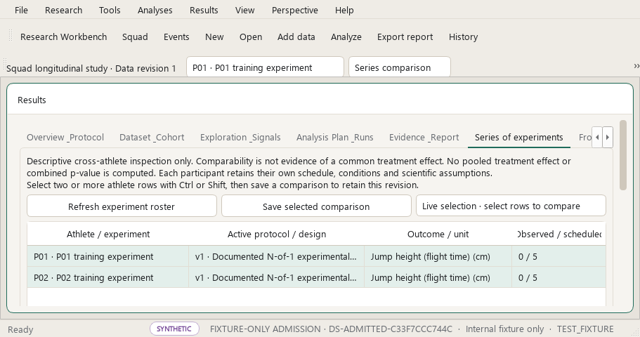
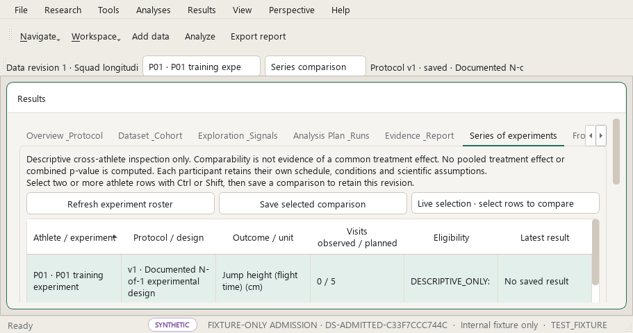
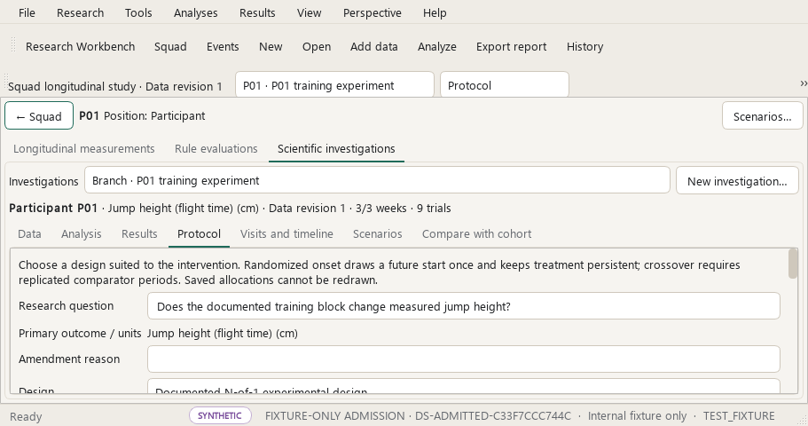
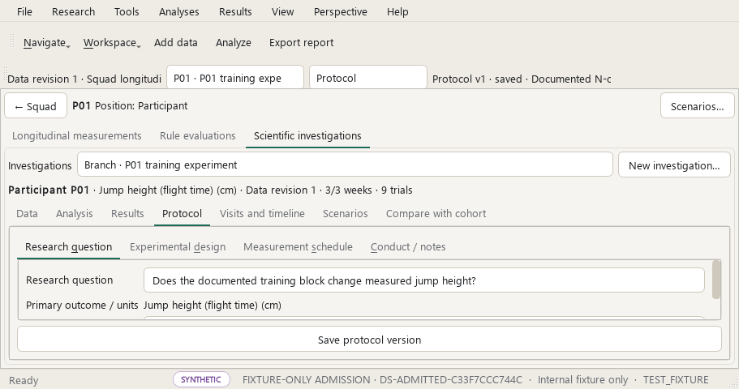
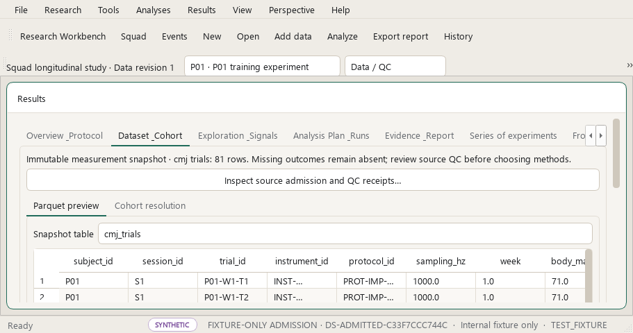
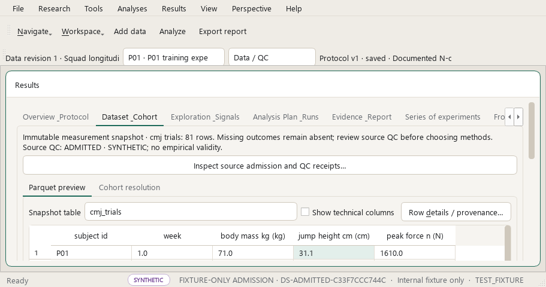

# RES-621 focused native simplification

Development continuation on 2026-11-17, starting at `1f6521c` in the existing
checkout. The longitudinal workflow is reused. No estimator, scientific method
contract, persistence schema, report renderer or operational dataset is changed.

## Native baseline before editing

`tests/test_research_compact.py` opened the actual MainWindow, athlete protocol,
series roster and admitted Parquet preview through the existing task selectors.
Two synthetic experiments and the existing 12-participant admission fixture were
used for geometry inspection; this is not a new usability study or a replacement
for the existing 20-athlete integrated journey.

Qt's **offscreen** platform, explicitly loaded Segoe UI 10, requested and actual
window sizes 911×480, 1024×640 and 1366×720. Baseline screenshots and JSON receipt:
`D:/SWE_HOME/codex_home/artifacts/res621-compact-before/`. Screenshots were inspected.
An initial capture accidentally left the Squad perspective active and was rejected;
the retained baseline uses supported scope/stage navigation to the actual surfaces.

| Surface | Reproduced baseline | Change and observed benefit |
| --- | --- | --- |
| Series roster | 1,335 px columns in 823 / 936 / 1,278 px viewports; horizontal scroll required even at 1366 | Six wrapping columns fit the viewport; zero horizontal-scroll maximum at all three geometries. Selection binds to the member stored with the item, so header sorting cannot change athlete identity. |
| Experiment comparison | Horizontal participant panels each required at least 330 px; more participants consumed width | Vertically stacked participant panels retain separate axes and complete timelines. Full captured design, eligibility and result/provenance are accessible through Inspect selected experiment details. |
| Data preview | Session/trial/instrument/protocol IDs and sampling preceded the week and measurements | Athlete and week lead, followed by body mass (kg), jump height (cm), force (N). Source QC and synthetic validity context precede the preview. Technical columns are one disclosure away; selected-row details retain every raw field and revision/snapshot identity. Full-value tooltips preserve precision. |
| Protocol | Save was outside the visible viewport at all three sizes; vertical scroll range 616 / 456 / 359 px | Four named sections: Research question, Experimental design, Measurement schedule, Conduct / notes. Outer scroll range is now zero at all three sizes and Save is always visible. Each section scrolls independently when needed. All existing form values survive section switching unchanged. |
| Toolbar | Nine actions occupied the workspace toolbar; protocol/result context overflowed at 911 | Three primary actions remain directly visible: Add data, Analyze, Export report. Navigate groups perspectives; Workspace groups New, Open, History and full research-context inspection. All nine existing actions retain keyboard access; protocol binding and revision remain visible at 911. |

## First independently validated change

Scoped command: `services/science/.venv/Scripts/python.exe
services/science/scripts/scoped_tests.py tests/test_research_compact.py
tests/test_native_experiment_series.py tests/test_native_experiments.py -x -ra`.
The native checks exercise sorting, selection and frozen capture identities,
full-row provenance, technical disclosure, canonical units, full-value tooltips,
existing two-athlete protocol/visit workflow, frozen history and stale callbacks.

No physical Windows display, hardware DPI or screen-reader verification is claimed.
The owner's modified manifest remains excluded; the private dataset is not opened.
Test writes are isolated by the existing bounded runner, with guarded scratch cleanup.

First change result: **7 passed in 22.87 s**, sampled scratch peak **4,539,752 bytes**, scratch removed. Evidence: D:/SWE_HOME/codex_home/artifacts/res621-compact-tables/.

## Second independently validated change

The protocol rearranges the existing fields and save/validation path, rather than
introducing another authoring model. Randomized-onset schedule and allocation
locks remain enforced. All scientific assumptions remain visible as wrapping
text in Schedule and available on the confirmation control's tooltip. Actual
exposure, deviations and missingness continue to be recorded in Observations;
the Conduct section explains that distinction and preserves legacy notes and
period summaries. Editing design, confirmations, timestamps and notes now also
updates the existing unsaved-edit indicator.

Primary shortcuts: Add data **Ctrl+Shift+I**, Analyze **Ctrl+Shift+A**, Export report
**Ctrl+Shift+X**. Existing New/Open and perspective shortcuts remain, and History
has **Ctrl+Shift+H**. Native Qt key events dispatch the three primary actions in
the test; this does not claim physical-keyboard interaction. Full context is
available through Workspace → Inspect research context, including the complete
title, athlete/investigation, protocol/result binding and stored identity context.
Long labels can still truncate in the toolbar; full text remains in tooltips and
the context dialog. Observed/scheduled counts sort numerically, and latest-result
labels lead with currency and scientific status ahead of the internal run ID.

Initial authoring/navigation/randomized validation: **8 passed in 31.05 s**,
4,098,942 sampled scratch bytes, cleanup confirmed. Broader native/scientific
journey validation: **16 passed in 90.07 s**, 17,340,431 sampled scratch bytes,
cleanup confirmed. A test initially relied on implicit row selection after Qt
shortcut dispatch; it now explicitly selects rows through QItemSelectionModel.
The failed run is not counted as passing. Subsequent numeric-sort and compact
randomized-schedule checks plus existing native series checks: **8 passed in
18.95 s**, 4,373,168 sampled scratch bytes, cleanup confirmed.

The final scope includes the existing 20-athlete, 12-week journey, revision append,
future-period amendment, independent CSV/session-mean reference, frozen report
byte comparison after restart, nonrandom inference rejection, exact randomized
inference, RES-716 method eligibility, series persistence and stale callbacks.
These test sets overlap; their counts must not be added as unique tests.

Final source validation, including all five compact tests and the unchanged
20-athlete journey, used the eight-file scope:
`tests/test_research_compact.py tests/test_twelve_week_workflow.py
tests/test_research_workflow.py tests/test_native_experiments.py
tests/test_native_experiment_series.py tests/test_native_randomized_onset.py
tests/test_native_method_suite.py tests/test_native_report_history.py -x -ra`
through `scripts/scoped_tests.py`: **18 passed in 89.67 s**, sampled scratch peak
**17,563,695 bytes**, exit 0 and scratch removed. No source changes followed this
run. First implementation commit: `f1b29a3`; the second commit records authoring,
toolbar, numeric-sort checks and this final evidence.

## Retained evidence and limits

The before/after receipts and 911×480 captures are retained in
`res621-simplification/` alongside this document. Full development captures are in
`D:/SWE_HOME/codex_home/artifacts/res621-compact-after/`, including all protocol
sections and compact frozen randomized schedule.

These are QWidget captures from offscreen Qt, not physical Windows display
verification or an installed-app campaign. At very compact height the individual
protocol sections still require vertical scrolling, and comparison timelines can
be long. Full values remain accessible through tooltips and details; this is not a
screen-reader acceptance claim. No new framework or global visual redesign.

The owner manifest SHA-256 remains
`835398DA594421BC9F04647992B0E9CEFD5DC844FD931D1964896B2E164A2587`.
The private dataset was not used; only disposable synthetic stores were opened.
No push, merge, installer build or release action was performed.
