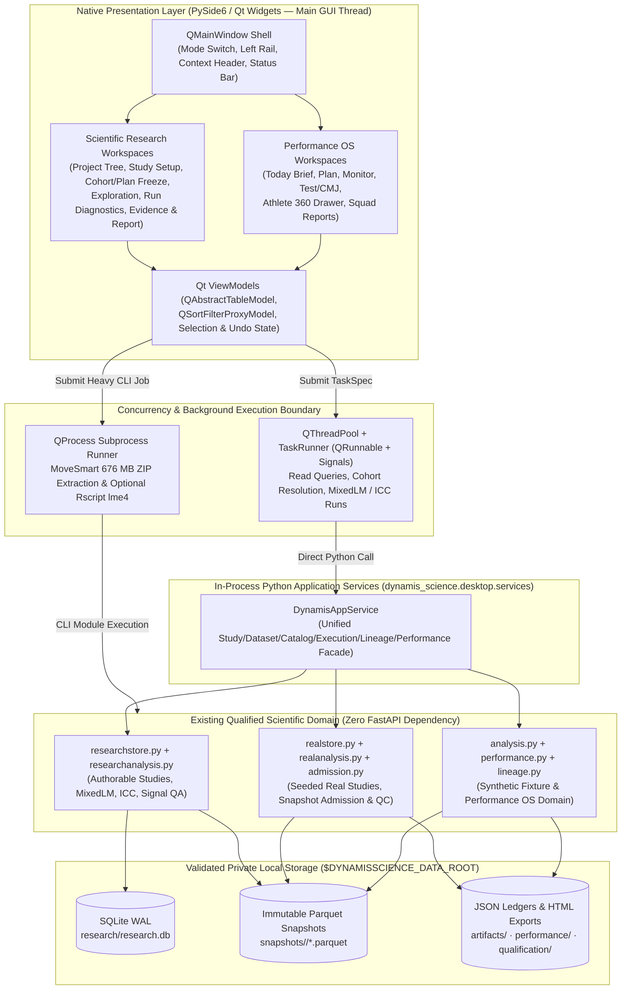

# DynamisScience Native Desktop System Design (`RES-605`)

**Status:** Frozen Architecture Specification — Awaiting Owner Sign-off  
**Issue:** `RES-605` (Blocks `RES-604`, Supersedes Web-Runtime Target of `RES-589`, Preserves Product & Domain Model of `RES-588`)  
**Repository Baseline:** `554b7048d3d6ed19a199e5dbb1eef666fd69eba2` (`main`, 7 commits ahead of `origin/main`)  
**Target Platform:** Windows 11 x64 Native Desktop (`PySide6` / Qt 6 Widgets, Python ≥ 3.12)  
**Primary Authoritative Deliverable:** `docs/desktop/SYSTEM_DESIGN.md`

---

## 1. Source-of-Truth Audit & Executive Summary

### 1.1 Issue Lineage & Architectural Pivot

| Issue | Role | Relationship to `RES-605` |
|---|---|---|
| `RES-588` | Full-Cycle Scientific Research & Performance OS | Established the scientific lifecycle (`Question → DatasetSnapshot → Cohort → Exploration → AnalysisSpec → AnalysisRun → Diagnostics → EvidenceArtifact → Report`), SQLite research store (`researchstore.py`), real-data analytical engine (`researchanalysis.py`), and Performance OS operational workflows (`performance.py`). Preserved in full as the domain authority. |
| `RES-589` | Windows Bootstrap & Hardening (`M0` Completed) | Established strict `DYNAMISSCIENCE_DATA_ROOT` boundary enforcement (`data_root.py`), pytest temporary-root isolation (`conftest.py`), SQLite Online Backup & WAL verification (`sqlite_recovery.py`), and verified private real-data snapshots in `D:\datasets\DynamisScience`. Superseded in its later milestones (`M1–M4` web/ops track) by the native desktop pivot. |
| `RES-605` | **Native Qt Desktop System Design Freeze (This Gate)** | Locks one coherent, minimal, Windows-first `PySide6` / Qt Widgets desktop architecture with direct in-process Python application services before any desktop code is written. |
| `RES-604` | Native Desktop Vertical Slice Implementation | Blocked by `RES-605`. Implements the first end-to-end native `PySide6` slice defined in Section 8 (Gate `G1`). |

### 1.2 Verified Git & Storage Baseline (Established Facts)

- **Repository Root:** `D:\projects\DynamisScience` on branch `main` at `554b7048d3d6ed19a199e5dbb1eef666fd69eba2` (clean working tree; 7 unpushed `RES-589` hardening commits `4e809ac..554b704`).
- **Private Scientific Data Root (`DYNAMISSCIENCE_DATA_ROOT`):** `D:\datasets\DynamisScience` (`1,032,104,990 B` / `0.961 GiB` including verified M0 backups; baseline operational dataset `904,764,885 B` / `0.843 GiB`), located strictly outside the Git repository and enforced by `services/science/dynamis_science/data_root.py`.
- **Admitted Snapshots & Research Database Verified on Disk:**
  1. `DS-REAL-MENDELEY-2C44490E08AD` — Holmberg et al. (2025) sprint priming & CMJ dataset (`DOI: 10.17632/6p99569x66.1`, CC BY 4.0): 21 athletes, 4 occasions (`Pre`, `Post 0`, `Post 10m`, `Post 24h`), 82 CMJ observations, 21 sprint rows. Derived summary scalars only; no raw force traces.
  2. `DS-REAL-MOVESMART-805259588272` — MoveSmart lower-limb wearable IMU + laboratory force-plate dataset (`DOI: 10.5281/zenodo.17376717`, CC BY-NC-SA 4.0, **non-commercial research restriction**): 10 participants (`P1`–`P10`), 398 matched trials across 5 activities (`Walking`, `Jogging`, `Running`, `Heel drop`, `Step drop`), `5,896,294` force samples at `1000 Hz` (`103.59 MB` Parquet), and `453,167` IMU samples at `~100 Hz` (`20.47 MB` Parquet). No CMJ trials and no hardware trigger / sample-level clock synchronization between force plate and IMU.
  3. `DS-SYNTH-001` — Deterministic synthetic football performance & biomechanics fixture (`dynamis-synthetic@1.0.0`, seed `20260924`): 28 athletes, 16 weeks, 884 CMJ trials, `397,150` force-trace samples at `1000 Hz`, 448 load rows, 448 wellness rows, and a 180 s match-tracking/pose segment. Stored in git-ignored `data/parquet/` and `data/artifacts/`. Explicit demonstration/regression fixture; zero empirical claims.
  4. `$DYNAMISSCIENCE_DATA_ROOT/research/research.db` — SQLite WAL database (`PRAGMA user_version = 1`, `synchronous = FULL`, `foreign_keys = ON`, 16 tables) storing scientist-authored projects (`PRJ-REAL-001`), studies (`STD-REAL-101`), monitoring workspaces (`MON-REAL-101`), versioned cohorts, frozen analysis plans, immutable runs, promoted evidence, figures, reports, and append-only audit logs.

### 1.3 Audit of Existing Python Engine & FastAPI Coupling

A line-by-line inspection of `services/science/dynamis_science/` confirms that **the core scientific domain, storage, and qualification modules already have zero FastAPI imports**:

| Module | Lines | FastAPI Coupling | Current Responsibility & Reuse Verdict |
|---|---:|---|---|
| `data_root.py` | 145 | **None** | Enforces external `DYNAMISSCIENCE_DATA_ROOT`, directory layout (`sources`, `extracted`, `quarantine`, `admitted`, `snapshots`, `qualification`, `manifests`, `artifacts`, `reports`, `performance`, `research`, `tmp`), and pytest sandbox guards. **Reuse unchanged.** |
| `contracts.py` | 485 | **None** | Pure Pydantic v2 data contracts (`DatasetSnapshot`, `Study`, `CohortDefinition`, `AnalysisSpec`, `AnalysisRun`, `EvidenceArtifact`, `FigureArtifact`, `ReportDocument`, `LineageGraph`, etc.). **Reuse unchanged.** |
| `researchstore.py` | 2,763 | **None** | SQLite WAL persistence, optimistic locking (`base_version`), state machine (`DRAFT → READY → ACTIVE → ANALYSIS → COMPLETED → ARCHIVED`), cohort & plan versioning/forking, run/evidence/report persistence, computed lineage graph, and self-contained HTML report export. **Reuse unchanged.** |
| `researchanalysis.py` | 752 | **None** | Real/synthetic study execution engine: `METH-REAL-TREND` (`statsmodels` MixedLM with multi-optimizer `lbfgs`/`bfgs`/`powell`/`nm` selection), `METH-REAL-DESC`, `METH-U-CHANGE`, `METH-REAL-RELIABILITY` (balanced `ICC(3,1)`, TE, CV), `METH-REAL-SIGNAL-QA`, `METH-U-DESC`, and explicit rejection of `METH-REAL-BODYWEIGHT`. **Reuse unchanged.** |
| `realstore.py` | 989 | **None** | Immutable Parquet snapshot admission, SHA-256 verification, read-only `immutable.json` sealing, and seeded reference studies (`STUDY-REAL-001`, `STUDY-REAL-002`). **Reuse unchanged.** |
| `realanalysis.py` | 1,495 | **None** | Reference real-data MixedLM, paired occasion change, repeated-trial GRF reliability, force/IMU signal QA, and provenance graph construction for `STUDY-REAL-001` and `STUDY-REAL-002`. **Reuse unchanged.** |
| `admission.py` | 695 | **None** | Candidate source registration, rights/license/privacy inspection, structural QC, quarantine, and promotion to immutable snapshots. **Reuse unchanged.** |
| `analysis.py` | 935 | **None** | Synthetic `STUDY-001` CMJ phase extraction, mixed-effects trend, impulse-momentum verification, fitness-fatigue state-space prototype, and qualification checks. **Reuse unchanged.** |
| `lineage.py` | 399 | **None** | Computed artifact lineage graph builder for synthetic/reference studies. **Reuse unchanged.** |
| `qualification.py` & `qualification_real.py` | 685 | **None** | Independent qualification against analytical fixtures and optional local `Rscript` (`R 4.6.2`, `lme4 2.1-0`). **Reuse unchanged.** |
| `ingest_real.py` & `extract_movesmart.py` | 217 | **None** | Idempotent CLI/module ingestion and filtered archive extraction for Mendeley and MoveSmart datasets. **Reuse unchanged (expose progress callbacks to Qt workers).** |
| `performance.py` | 1,981 | **Coupled (`APIRouter`, `HTTPException`, `Query`, `HTMLResponse`)** | Contains all Performance OS domain calculations (`today`, `athletes`, `squad_weeks`, `athlete_detail`, `load_overview`, `log_session`, `add_athlete_note`, `get_plan`, `update_plan`, `publish_plan`, `tests`, `run_reliability`, `movement`, `units`, `research_link`, `create_report`, `freeze_report`, `export_report`) decorated directly as FastAPI route handlers. **Decouple HTTP decorators/exceptions from pure Python functions.** |
| `api.py` | 2,568 | **Coupled (`FastAPI`, `HTTPException`, route handlers)** | Mixes FastAPI HTTP wiring with **unified cross-store domain dispatch** (`overview`, unified `studies` list, unified `study_detail`, `resolve_cohort`, `explore_longitudinal` DuckDB queries, `force_trials`, `force_trial`, `match_detail`, `datasets`, `dataset_detail`, unified `execute_analysis`, unified `promote_evidence`, unified `report`, unified `lineage`). **Extract unified dispatch into pure Python `ApplicationFacade`; keep `api.py` as a thin HTTP adapter until web retirement.** |

---

## 2. Binding Architectural Constraints & Locked Topology

### 2.1 Locked Architecture Stack

DynamisScience Desktop is a **single-user, local-first, Windows x64 native scientific workstation** built on:

1. **Presentation Layer:** `PySide6` (`QtWidgets`, `QtCore`, `QtGui`) + `pyqtgraph` (high-frequency 1000 Hz biomechanical traces & interactive scientific plots) + `QTextBrowser` / native file save for frozen HTML/SVG reports.
2. **Application Service Layer:** Direct in-process Python `DynamisAppService` (`services/science/dynamis_science/desktop/services.py`) and asynchronous Qt worker adapters (`QThreadPool` + `QRunnable` for in-process queries/models; `QProcess` for heavy archive ingestion and optional `Rscript` qualification).
3. **Scientific Domain Layer:** Existing qualified Python modules (`researchstore`, `researchanalysis`, `realstore`, `realanalysis`, `admission`, `analysis`, `performance`, `lineage`, `qualification`, `qualification_real`).
4. **Storage & Artifact Layer:**
   - **Research Metadata & Audit Ledger:** SQLite 3 (`$DYNAMISSCIENCE_DATA_ROOT/research/research.db`) in `WAL` mode with `synchronous = FULL`, `foreign_keys = ON`, and `BEGIN IMMEDIATE` write transactions.
   - **Analytical Datasets:** Immutable Apache Parquet files queried in-process via `Polars` (`>=1.8`) and `DuckDB` (`>=1.1`) and inspected lazily via `pyarrow.parquet` (`>=17.0`).
   - **Private Filesystem Artifacts:** External `DYNAMISSCIENCE_DATA_ROOT` containing raw `sources/`, `extracted/`, `quarantine/`, `snapshots/`, `artifacts/`, `qualification/`, and `performance/`.



### 2.2 Explicit Non-Goals & Prohibited Dependencies

The desktop architecture **strictly forbids**:
- Mandatory `Next.js`, `Node.js`, `React`, `npm`, `FastAPI`, `Uvicorn`, or localhost HTTP loopback servers at desktop runtime.
- `QtWebEngineWidgets` / embedded Chromium (`QtWebEngine` adds >120 MB of binary weight and recreates a browser inside Qt; self-contained HTML reports are previewed via lightweight native summary tables/SVG and opened or exported cleanly via `QTextBrowser` / OS file association).
- `Electron`, `Tauri`, `PostgreSQL`, `Redis`, `Celery`, `Kubernetes`, microservices, or distributed compute clusters.
- Rewriting or altering the mathematical implementation of any qualified scientific method (`METH-REAL-TREND`, `METH-REAL-RELIABILITY`, `METH-REAL-SIGNAL-QA`, `METH-REAL-DESC`, `METH-U-CHANGE`, `METH-CMJ-TREND`, `METH-CMJ-IMPULSE`).
- Multi-tenant cloud authentication, RBAC middleware, or telemetry uploaders.

---

## 3. Complete Product Model & End-to-End Workflows

### 3.1 Reconciling Performance OS and Scientific Research

DynamisScience serves two tightly linked but epistemically separated workflows inside a single native workstation:

1. **Scientific Research Mode (Primary Epistemic Authority):**
   - Operates on **admitted real-data snapshots** (`DS-REAL-MENDELEY-2C44490E08AD`, `DS-REAL-MOVESMART-805259588272`, or newly admitted datasets) and explicitly labelled synthetic fixtures (`DS-SYNTH-001`).
   - Enforces the full 9-stage scientific chain:
     `Question → DatasetSnapshot → Cohort → Exploration → AnalysisSpec → AnalysisRun → Diagnostics → EvidenceArtifact → Report`
   - Distinguishes **Study** (`kind = "STUDY"`, pre-specified hypothesis testing with frozen cohort and frozen analysis plan) from **Monitoring Workspace** (`kind = "MONITORING"`, recurring longitudinal observation and signal QA over a frozen or versioned cohort).
2. **Performance OS Mode (Operational Squad Workstation):**
   - Follows the operational loop: `Today → Plan → Monitor → Test → Research → Report`, plus the persistent **Athlete 360** slide-over/dock inspector.
   - Currently bound to the deterministic synthetic squad fixture (`DS-SYNTH-001`, 28 athletes, 16 weeks) with persistent operational records in `$DYNAMISSCIENCE_DATA_ROOT/performance/` (`plan.json`, `sessions.json`, `notes.json`, `test_assessments.json`, `reports.json`).
   - Links operational questions to promoted scientific evidence via the `Research Link` bridge without conflating daily coaching triage flags with causal or clinical claims.

### 3.2 Authentic Real Measurements vs Synthetic Demonstration Data

To prevent synthetic demonstration data from ever being mistaken for empirical findings, the desktop application enforces **three hard separation rules**:

1. **Persistent Provenance Badge in Top Context Header:**
   - Every study, dataset, run, and workspace displays a non-dismissible badge in the `QMainWindow` context header:
     - `REAL DATA · CC BY 4.0` (e.g., `DS-REAL-MENDELEY-2C44490E08AD`, emerald/teal border)
     - `REAL DATA · CC BY-NC-SA 4.0 (NON-COMMERCIAL)` (e.g., `DS-REAL-MOVESMART-805259588272`, amber border)
     - `SYNTHETIC FIXTURE · DS-SYNTH-001 (NO EMPIRICAL CLAIMS)` (muted slate/copper border; permanent banner on all Performance OS and `STUDY-001` surfaces).
2. **Catalog & Selector Grouping:**
   - Dataset and Study selectors group entries under explicit section headers: **Admitted Real Datasets / Studies** first, followed by **Synthetic Demonstration & Regression Fixtures** (which can be hidden via a single toolbar toggle `Show Synthetic Fixtures`).
3. **Export Watermarking:**
   - Any report exported from a study bound to `DS-SYNTH-001` or Performance OS automatically embeds `"synthetic": true` in its provenance manifest and renders the limitation statement `"Synthetic fixture DS-SYNTH-001: no real athletes, clubs or measurements"` in the exported HTML header and footer.

### 3.3 End-to-End Desktop User Journey (Launch to Report Export)

#### Step 1: Launch & Data-Root Gate
1. User launches `DynamisScience.exe` (or `python -m dynamis_science.desktop`).
2. Before constructing workspaces, `StartupController` resolves `DYNAMISSCIENCE_DATA_ROOT`:
   - Order of precedence: CLI `--data-root` → environment variable `DYNAMISSCIENCE_DATA_ROOT` → stored user setting in `QSettings("Dynamis", "DynamisScience")` → default `%LOCALAPPDATA%\DynamisScience` (or previously configured `D:\datasets\DynamisScience`).
   - Validates path via `data_root.validate_data_root()` (must be absolute and outside the repository tree).
   - If invalid or uninitialized, presents a modal **Data Root Setup Dialog** allowing the user to select an existing private data root (e.g. `D:\datasets\DynamisScience`) or initialize a new directory layout via `ensure_layout()`.
3. Runs fast startup integrity check (`PRAGMA quick_check` and `PRAGMA foreign_key_check` on `research.db`, plus snapshot directory manifest existence check) on a background startup worker while displaying a compact native splash/status stage.
4. Opens `QMainWindow` directly into the **Scientific Research Workspace** (or restores the last active study/workspace from `QSettings`).

#### Step 2: Project & Study / Monitoring Creation
1. From the left **Project & Study Browser** (`QTreeView`), the user inspects:
   - **Scientist-Authored Projects** (`PRJ-REAL-001`, plus user-created projects) containing **Studies** (`STD-*`) and **Monitoring Workspaces** (`MON-*`).
   - **Reference Real-Data Studies** (`STUDY-REAL-001` Mendeley Sprint Priming, `STUDY-REAL-002` MoveSmart Force/IMU) — read-only reference templates that can be inspected, re-run, or cloned into an editable project.
   - **Synthetic Reference Study** (`STUDY-001`) — read-only synthetic reference.
2. Clicking **New Project** (`Ctrl+Shift+N`) or **New Study / Monitoring Workspace** (`Ctrl+N`) opens a native `QDialog` bound to `researchstore.create_project()` or `researchstore.create_study()`:
   - Captures `title`, `kind` (`STUDY` vs `MONITORING`), `dataset_snapshot_id` (chosen from admitted snapshots), `design`, `question_statement`, `primary_outcome`, `estimand`, `population`, `exposure`, `comparison`, and initial `hypotheses`.
   - Persists to `research.db` (`entities` + `entity_versions` v1 + `cohorts` v1 `DRAFT` + `plans` v1 `DRAFT` + `reports` v1 `DRAFT` + `audit` entry) inside a single `BEGIN IMMEDIATE` transaction.

#### Step 3: Dataset Admission, Qualification & Selection
1. In the **Datasets & Admission** workspace, the user inspects admitted snapshots (`DS-REAL-MENDELEY-2C44490E08AD`, `DS-REAL-MOVESMART-805259588272`, `DS-SYNTH-001`), candidate sources (`admission.list_sources()`), and quarantined files.
2. Each snapshot displays:
   - Source DOI, license (`CC BY 4.0`, `CC BY-NC-SA 4.0`), commercial-use flag, de-identification status, Parquet table list, exact row counts, SHA-256 checksums, and `immutable.json` seal status.
   - Schema & column inspector (`QTableView` backed by `ParquetPreviewTableModel`) and coverage matrix (subjects × occasions/activities).
3. To admit a new local file (`.csv`, `.tsv`, `.parquet`, `.xlsx`, `.json`), the user clicks **Register Local Source…** (`QFileDialog`), enters publisher/license/privacy metadata, runs `admission.inspect_source()` + `admission.admit_source()` in a background worker, and either promotes the validated Parquet snapshot or inspects quarantine reasons.

#### Step 4: Cohort Definition, Resolution & Freeze
1. Inside a Study's **Setup & Cohort** tab, the user edits the declarative cohort criteria (`name`, `description`, `criteria.occasions`, `criteria.activities`, `criteria.include_subjects`, `criteria.exclude_subjects`, `criteria.min_trials`, `criteria.complete_occasions_only`, `criteria.valid_only`).
2. Clicking **Preview / Resolve Cohort** executes `researchstore.resolve_cohort_snapshot()` off the GUI thread and updates the **Cohort Resolution Table**:
   - Shows included subjects (`n`), excluded subjects with explicit exclusion reasons (`excluded_subjects`), total observations (`n_observations`), and occasion/activity breakdown.
3. Clicking **Save Cohort Draft** (`Ctrl+S`) increments `cohorts.version` with optimistic concurrency check (`base_version`) and appends a row to `cohort_versions`.
4. Clicking **Freeze Cohort** transitions the cohort status from `DRAFT` to `FROZEN` (`frozen_at` timestamp + SHA-256 `rule_hash`). Once frozen, in-place edits are blocked (`ResearchConflict`); clicking **Fork New Cohort Version** creates a new `DRAFT` cohort (`parent_cohort_id = frozen.id`) so historical runs remain bound to the exact frozen cohort.

#### Step 5: Exploration & Signal Inspection
1. In the **Exploration & Signals** tab, the scientist visually explores the resolved cohort before or alongside formal modeling:
   - **Longitudinal / Occasion View (`DS-REAL-MENDELEY`, `DS-SYNTH-001`):** Plots group mean ± 95% CI or SD across occasions/weeks, overlays individual athlete trajectories (`spaghetti` toggle), and displays a synchronized `QTableView` of occasion values and missing slots.
   - **High-Frequency Force & IMU Signal Inspector (`DS-REAL-MOVESMART`, `DS-SYNTH-001`):** Lists trials in a filterable `QTableView` (by subject, activity, valid/flagged state) and renders selected `1000 Hz` vertical GRF (`Fz`), support intervals, baseline windows, and `~100 Hz` IMU resultant acceleration in a hardware-accelerated `pyqtgraph.PlotWidget` with pan/zoom and crosshair readout.
2. Exploration explicitly carries an `EXPLORATORY — NOT PROMOTABLE AS EVIDENCE` banner; exploratory views cannot be cited in a report without executing a frozen `AnalysisSpec`.

#### Step 6: Analysis Plan Configuration, Freeze & Execution
1. In the **Analysis Plan & Runs** tab, the user selects a qualified method compatible with the study's snapshot (`researchstore.list_methods(snapshot_id)`):
   - `METH-REAL-TREND`: Linear mixed-effects change across occasions (`statsmodels` MixedLM random intercept + slope, ML estimation, multi-optimizer selection).
   - `METH-REAL-DESC`: Occasion-level descriptive distribution (mean, SD, median, IQR, min/max).
   - `METH-U-CHANGE`: Paired change between two selected occasions (`baseline_occasion`, `comparison_occasion`, paired *t* CI, Hedges' *g*).
   - `METH-REAL-RELIABILITY`: Repeated-trial peak GRF reliability (`ICC(3,1)`, Shrout-Fleiss 95% CI, Typical Error in N, within-subject CV%, balanced trial cap `max_trials`).
   - `METH-REAL-SIGNAL-QA`: Force-plate & IMU signal quality audit (sampling intervals, NaN counts, baseline drift, support impulse checks).
   - `METH-U-DESC`: Activity-stratified peak force and support impulse summaries.
   - *Explicitly Blocked Method:* `METH-REAL-BODYWEIGHT` is shown with status `UNAVAILABLE` and its scientific rejection reason (`MoveSmart Zenodo deposit contains no participant body mass; dividing Newtons by an assumed mass is prohibited`).
2. For `kind == "STUDY"`, executing a primary confirmatory run requires **freezing both the Cohort and the Analysis Plan** (`researchstore.freeze_plan()`). When both are frozen, the study automatically transitions from `DRAFT` to `READY`.
3. Clicking **Execute Analysis Run** (`Ctrl+R`) dispatches `researchstore.execute_study_run()` to the background `QThreadPool`:
   - Status bar shows active task spinner, elapsed time, and method ID.
   - Upon completion, persists the immutable `AnalysisRun` record (with `reproducibility_key`, `result_digest`, `software_versions`, `parameters`, `metrics`, `estimates`, `diagnostics`, `warnings`, `limitations`, and `figures_json`) and transitions the study state to `ACTIVE` / `ANALYSIS`.

#### Step 7: Diagnostics, Uncertainty & Limitations Review
1. Selecting any completed `AnalysisRun` in the **Run History Table** populates the **Results & Diagnostics Split View**:
   - **Estimates Table:** Point estimate, standard error, 95% confidence interval (`low`, `high`), *p*-value (where applicable), effect size (`d_z`, Hedges' `g`, `ICC(3,1)`), physical units (`cm`, `N`, `N·s`, `%`), and computed plain-language interpretation.
   - **Diagnostics Panel:** Optimizer convergence status (`converged: true`, selected optimizer e.g. `powell` or `lbfgs`, log-likelihood `-208.312`, AIC/BIC, random-effects variance-covariance matrix, residual normality/homoscedasticity summaries, or ANOVA `MS_between` / `MS_within`).
   - **Assumptions, Warnings & Mandatory Limitations:** Explicit list of data and design limitations attached to the run (e.g., single-arm observational design with no control group; unnormalized Newtons; no IMU-to-force clock sync).

#### Step 8: Idempotent Evidence Promotion & Provenance Lineage
1. From a completed `AnalysisRun`, the scientist clicks **Promote to Evidence Artifact**.
2. `researchstore.promote_run_evidence()` creates (or returns existing, idempotently by `(entity_id, analysis_run_id)`) the immutable `EvidenceArtifact` (`EVD-*`) and associated `FigureArtifact` (`FIG-*`), recording:
   - Exact `analysis_run_id`, `analysis_spec_id`, `cohort_id` + version, `dataset_snapshot_id` + SHA-256 checksums, `result_digest`, `quality` badge (`VALID` vs `WARN`), and mandatory `limitations`.
3. Clicking **Inspect Lineage** opens the **Provenance Lineage Inspector** (dockable panel or tab) displaying the computed DAG from `researchstore.lineage_graph()` / `lineage.build_lineage_graph()`:
   - Traces every node (`Source → Snapshot → Cohort → AnalysisSpec → AnalysisRun → EvidenceArtifact → FigureArtifact → Report`) with clickable node inspection showing exact SHA-256 digests, timestamps, and parameters.

#### Step 9: Report Authoring, Version Freezing & Self-Contained HTML Export
1. In the **Report & Export** tab, the user curates the study report:
   - Selects which promoted `EvidenceArtifact` and `FigureArtifact` items are cited (`update_study_report()`).
   - Reviews auto-populated sections (Question & Design, Dataset & Cohort, Methods & Estimand, Results Table, Figures, Mandatory Limitations, and Embedded Reproducibility Manifest).
   - Adds optional narrative notes (`summary`, `conclusion`, `recommendations`) — while the software prevents editing or overriding any computed numerical estimate, confidence interval, or limitation.
2. Clicking **Freeze Report Version** invokes `researchstore.freeze_study_report()`, writing an immutable snapshot to `report_versions` (`v1`, `v2`, …) with a SHA-256 `content_hash` and optionally transitioning the study state to `COMPLETED`.
3. Clicking **Export HTML Report…** (`Ctrl+E`) calls `researchstore.export_html(entity_id, version)` and opens a native `QFileDialog.getSaveFileName()` (defaulting to `<entity_id>-v<version>-report.html`), saving the self-contained dark-mode HTML + inline SVG + JSON provenance manifest file to disk and offering a one-click **Open in Default Browser / Folder** action.

### 3.4 Empty, Unavailable, Invalid, Loading & Failure States

Every desktop surface implements deterministic, non-ambiguous state handling:

| State | Visual & Interactive Behavior in Qt Widgets |
|---|---|
| **Empty State** | Explicit message panel (`QLabel` + primary `QPushButton` action) explaining *why* the table/plot is empty and the exact next action (e.g., *"No runs executed for Plan PLN-REAL-101 v1. Freeze the cohort and analysis plan, then click Execute Analysis Run (Ctrl+R)."*). Never shows a blank white/black box or fake placeholder numbers. |
| **Unavailable Method / Module** | Rendered in lists with an `[UNAVAILABLE]` badge, disabled execution button, and an inline scientific explanation box. Examples: `METH-REAL-BODYWEIGHT` on MoveSmart (no body mass recorded); Injury Surveillance / Return-to-Play in Performance OS (no injury or exposure table admitted). |
| **Invalid Input / Precondition** | Inline field validation border + diagnostic banner before submission (e.g., attempting to run `METH-U-CHANGE` with identical baseline and comparison occasions, or attempting to edit a `FROZEN` cohort without forking). |
| **Loading / Running State** | Non-blocking skeleton/overlay indicator inside the target pane + status bar progress widget (`QProgressBar` + task label + elapsed timer + `Cancel` button where supported). The main window, navigation rail, and read-only inspection tabs remain 100% responsive. |
| **Failure / Conflict State** | Structured native alert banner or `QMessageBox` mapping domain exceptions: `ResearchConflict` (409) offers **"Reload Latest State"** or **"Fork New Version"**; `ResearchValidation` (422) highlights the offending parameter; unhandled worker exceptions log full tracebacks to `$DYNAMISSCIENCE_DATA_ROOT/logs/dynamis_desktop.log` and offer a **"Copy Diagnostic Report"** button. |

### 3.5 Scope Allocation Across Implementation Gates

| Capability Area | `RES-604` Initial Vertical Slice (Gate `G1`) | Subsequent Native Parity (`G2` / `G3`) | Explicitly Deferred (`P2`) |
|---|---|---|---|
| **Startup & Data Root Validation** | **Included (`G1`)**: `DYNAMISSCIENCE_DATA_ROOT` validation, first-run directory picker, SQLite health check, `QMainWindow` shell. | Automatic pre-migration backup wizard & settings editor (`G2`). | Multi-profile switching UI. |
| **Study & Dataset Catalog** | **Included (`G1`)**: Browse all Projects, Authored Studies (`STD-REAL-101`), Monitoring (`MON-REAL-101`), Reference Real Studies (`STUDY-REAL-001`, `STUDY-REAL-002`), Synthetic (`STUDY-001`), and admitted Snapshots with provenance/checksums. | Create/edit new Projects, Studies, Monitoring Workspaces, and admit new local dataset files via UI (`G2`). | Automated remote Zenodo/Mendeley API downloader. |
| **Cohort & Analysis Execution** | **Included (`G1`)**: Inspect/resolve cohorts, configure & execute qualified analysis runs (`METH-REAL-TREND`, `METH-REAL-RELIABILITY`, `METH-REAL-SIGNAL-QA`, `METH-U-CHANGE`, `METH-REAL-DESC`) off the GUI thread, view estimates/diagnostics/limitations. | Interactive cohort draft editing, cohort freeze/fork UI, plan freeze/fork UI, custom investigation scratchpad (`G2`). | Custom user-defined Python script plugins. |
| **Visualizations & Signal Inspector** | **Included (`G1`)**: Longitudinal occasion/week trajectory plot + MoveSmart/Synthetic 1000 Hz force & IMU trace viewer (`pyqtgraph`) + lazily paged Parquet table preview (`QTableView`). | Match 2D pitch tracking & skeletal pose playback canvas (`G3`). | 3D hardware-accelerated skeletal mesh viewer. |
| **Evidence, Lineage & Report Export** | **Included (`G1`)**: Promote run to `EvidenceArtifact`, inspect full provenance lineage DAG, freeze report version, and export self-contained HTML report to disk. | Side-by-side report version diffing (`G2`). | Native PDF print-engine typesetter (HTML print stylesheet already covers PDF via browser print). |
| **Performance OS Workspaces** | Read-only summary bridge / dataset inspection in `G1`. | **Full Parity (`G3`)**: Native `Today`, `Plan`, `Monitor`, `Test`, `Report`, and `Athlete 360` drawer. | Live streaming wearable Bluetooth/ANT+ ingestion. |

---

## 4. Native Qt Widgets UI/UX System & Information Architecture

### 4.1 Design Principles & Qt Widget Selection

DynamisScience Desktop is designed as a **high-density, keyboard-first scientific workstation** inspired by native laboratory and telemetry tools (MATLAB/Simulink, Igor Pro, GoldenCheetah), **not** a web page ported into Qt:

- **No Deep Card Nesting:** Web-style padded cards inside cards are replaced by `QSplitter`-divided panes, dense `QTableView` grids with monospace numerical columns, and compact `QFormLayout` parameter inspectors.
- **Deliberate Native Widget Mapping:**
  - `QMainWindow`: Single top-level window owning the persistent menu bar (`QMenuBar`), top context toolbar (`QToolBar`), central `QSplitter` workspace, dockable side inspectors (`QDockWidget`), and bottom `QStatusBar`.
  - `QTreeView` + custom `QAbstractItemModel`: Hierarchical navigation of `Projects → Studies / Monitoring → Cohorts / Plans / Runs / Reports` and `Datasets → Tables`.
  - `QTableView` + `QAbstractTableModel` + `QSortFilterProxyModel`: All tabular views (participant rosters, cohort resolution tables, Parquet dataset previews, run history, estimates, audit logs). Provides virtualized row rendering, column sorting, right-aligned monospace numbers (`IBM Plex Mono` / `Cascadia Mono`), and copy-to-clipboard (`Ctrl+C` TSV/CSV).
  - `QSplitter` (horizontal and vertical, with persistent sizes in `QSettings`): Allows scientists to resize the project browser, central analysis table/plot, and right-hand provenance/diagnostics inspector freely.
  - `QDockWidget`: Used for the **Provenance & Lineage Inspector** and **Athlete 360 Inspector** so users on multi-monitor laboratory setups can undock lineage or athlete detail onto a second display.
  - `pyqtgraph.PlotWidget` (`GraphicsLayoutWidget`): Native Qt `QGraphicsView`-backed scientific plotting for 1000 Hz force-time traces, IMU acceleration series, occasion trend plots with 95% confidence bands, and Bland-Altman / residual diagnostic plots.

### 4.2 Complete Screen Inventory & Navigation Hierarchy

```
QMainWindow (DynamisScience Workstation)
├── Top Context Bar (Mode Switcher | Active Study/Snapshot Badge | License/Synthetic Pill | Quick Find Ctrl+K)
├── Mode 1: Scientific Research Workbench (Primary Mode)
│   ├── Left Pane (QTreeView): Project, Study & Dataset Navigator
│   │   ├── Scientist Projects (PRJ-REAL-001, ...)
│   │   │   ├── Studies (STD-REAL-101, ...)
│   │   │   └── Monitoring Workspaces (MON-REAL-101, ...)
│   │   ├── Reference Real-Data Studies (STUDY-REAL-001, STUDY-REAL-002)
│   │   ├── Synthetic Reference (STUDY-001)
│   │   └── Admitted Datasets & Sources (DS-REAL-MENDELEY, DS-REAL-MOVESMART, DS-SYNTH-001)
│   ├── Center Pane (QTabWidget — Active Study / Dataset Workspace)
│   │   ├── Tab 1: Overview & Protocol (Question, Estimand, Hypotheses, State Machine, Audit Trail)
│   │   ├── Tab 2: Dataset & Cohort (Snapshot Checksums, Declarative Cohort Builder, Resolved Subject Table, Freeze/Fork)
│   │   ├── Tab 3: Exploration & Signals (Longitudinal Trajectories + 1000 Hz Force/IMU Signal Waveform Inspector)
│   │   ├── Tab 4: Analysis Plan & Runs (Method Selector, Parameter Form, Plan Freeze/Fork, Run Execution, Estimates & Diagnostics)
│   │   └── Tab 5: Evidence & Report (Promoted Evidence Table, Figure Gallery, Report Composer, Freeze Version & Export HTML)
│   └── Right Dock (QDockWidget): Provenance Lineage & Artifact Inspector
│       ├── Lineage DAG Table/Tree (Upstream & Downstream Nodes)
│       └── Selected Node Cryptographic & Parameter Metadata
└── Mode 2: Performance OS Workbench (Squad Operations — Gate G3)
    ├── Left Rail (QListWidget): Operational Cadence Navigation
    │   ├── 1. Today (Daily Triage, Squad Pulse, Attention Queue, Readiness/Load Brief)
    │   ├── 2. Plan (16-Week Mesocycle Load Targets, Draft vs Published Comparison)
    │   ├── 3. Monitor (Longitudinal Load & Wellness, Session Logger, 2D Match Tracking/Pose)
    │   ├── 4. Test (CMJ Force-Time Phase Inspector, Squad Reliability ICC/TE/CV Runner)
    │   └── 5. Reports (Coach, Athlete, Medical, Board Briefs & HTML Export)
    └── Right Dock (QDockWidget): Athlete 360 Inspector (Selected Athlete Profile, Individual Baseline Change, Notes)
```

### 4.3 Reviewable Native Wireframes (Central Research Workflow)

#### Wireframe A: Main Window Shell & Analysis / Diagnostics Workspace (`Tab 4: Analysis Plan & Runs`)

```
+----------------------------------------------------------------------------------------------------------------------+
| File   Study   Dataset   Analysis   View   Tools   Help                                             [_] [Max] [Close]|
+----------------------------------------------------------------------------------------------------------------------+
| [Research Workbench *] [Performance OS] | Study: STD-REAL-101 (ACTIVE) | Snapshot: DS-REAL-MENDELEY [REAL · CC BY 4] |
|                                                                                      [Quick Jump (Ctrl+K)...       ] |
+---------------------------+---------------------------------------------------------------+--------------------------+
| PROJECTS & STUDIES        | [1.Overview] [2.Cohort (FROZEN)] [3.Explore] [4.Analysis & Runs*] [5.Evidence & Report]  |
| +-----------------------+ | +-----------------------------------------------------------+ | PROVENANCE & LINEAGE [x] |
| | v PRJ-REAL-001        | | | ANALYSIS PLAN: PLN-REAL-101 (v1 · FROZEN)   [Fork Plan]   | | Selected: RUN-REAL-1001  |
| |   * STD-REAL-101      | | | Method: [METH-REAL-TREND: MixedLM Occasion Change     v]  | | Status:   COMPLETED      |
| |     MON-REAL-101      | | | Outcome: cmj_height_cm (cm)  | Cohort: COH-REAL-101 (n=21)| | Digest:   sha256:8f3c... |
| | v Reference Studies   | | | Formula: cmj_height_cm ~ occasion_c + (1+occasion_c|subj) | |                          |
| |     STUDY-REAL-001    | | | [  Execute Analysis Run (Ctrl+R)  ]  [Promote Evidence]   | | UPSTREAM LINEAGE CHAIN   |
| |     STUDY-REAL-002    | | +-----------------------------------------------------------+ |  [SRC-MENDELEY]          |
| | v Synthetic Fixtures  | | | RUN HISTORY (QTableView)                                  | |    | admitted_as         |
| |     STUDY-001 [SYNTH] | | | Run ID        | Method          | Status    | LogLik | n  | |  [DS-REAL-MENDELEY-...]  |
| | v Admitted Snapshots  | | | >RUN-REAL-1001| METH-REAL-TREND | COMPLETED | -208.3 | 82 | |    | restricted_to       |
| |     DS-REAL-MENDELEY  | | |  RUN-REAL-1002| METH-U-CHANGE   | COMPLETED |   —    | 20 | |  [COH-REAL-101 (FROZEN)] |
| |     DS-REAL-MOVESMART | | +-----------------------------------------------------------+ |    | analysed_by         |
| |     DS-SYNTH-001      | | | ESTIMATES & UNCERTAINTY             | MODEL DIAGNOSTICS   | |  [PLN-REAL-101 (FROZEN)] |
| +-----------------------+ | | Term      | Est.   | SE    | 95% CI | Optimizer: powell   | |    | executed_as         |
| [ + New Study (Ctrl+N)  ] | | Intercept | 40.312 | 1.385 | 37.59..| Converged: YES      | | *[RUN-REAL-1001]         |
| [ + Admit Dataset...    ] | | Occasion  | +0.296 | 0.141 | +0.02..| LogLik:   -208.312  | |    | promoted_to         |
|                           | |           |        |       | p=.036 | Var(Int):  39.204   | |  [EVD-REAL-1001]         |
|                           | | +-----------------------------------+ Var(Slp):   0.181   | |                          |
|                           | | | [Plot: Occasion Mean + 95% CI &   | Resid Var:  2.419   | | MANDATORY LIMITATIONS    |
|                           | | |  Residual Q-Q (pyqtgraph)]        | Qualification: PASS | | - Single-arm design; no  |
|                           | | |   42 |    o---o---o---o           | (vs R 4.6.2 lme4)   | |   parallel control group |
|                           | | |   38 +----+---+---+---+           |                     | | - Derived CMJ scalars    |
|                           | | |      Pre P0 P10m P24h             |                     | |   only; no force traces  |
+---------------------------+---------------------------------------------------------------+--------------------------+
| READY | Data Root: D:\datasets\DynamisScience (Verified) | SQLite WAL: OK | Background Tasks: Idle       | RAM: 148M |
+----------------------------------------------------------------------------------------------------------------------+
```

#### Wireframe B: Cohort Builder, Parquet Inspector & High-Frequency Signal Viewer (`Tab 2` & `Tab 3`)

```
+----------------------------------------------------------------------------------------------------------------------+
| STUDY-REAL-002 · MoveSmart Wearable IMU + Force Plate | Snapshot: DS-REAL-MOVESMART [REAL · CC BY-NC-SA 4.0 NON-COMM]|
+----------------------------------------------------------------------------------------------------------------------+
| [1.Overview] [2.Dataset & Cohort] [3.Exploration & Signals*] [4.Analysis & Runs] [5.Evidence & Report]               |
+---------------------------------------------------+------------------------------------------------------------------+
| TRIAL & SIGNAL SELECTOR (QTableView + ProxyFilter)| 1000 Hz VERTICAL GRF (Fz) & ~100 Hz IMU ACCELERATION (pyqtgraph) |
| Activity: [All (5) v]  Subject: [All (10) v]      | Trial: P01-walk0001  | Plates: 3 | Peak Fz: 842.4 N | Imp: 391 Ns|
| Search:   [walk0001                   ] [Valid *] | +--------------------------------------------------------------+ |
| +-----------------------------------------------+ | | Fz (N)                                    [Support Interval] | |
| | Trial ID     | Subj | Activity | Samples| Peak| | |  900 |          /\        /\                                 | |
| | >P01-walk0001| P01  | Walking  |  14,820| 842N| | |  600 |         /  \______/  \                                | |
| |  P01-walk0002| P01  | Walking  |  14,610| 838N| | |  300 |        /              \                               | |
| |  P01-run0001 | P01  | Running  |  12,400|1894N| | |    0 +-------/----------------\----------------------------- | |
| |  P02-heel0001| P02  | Heel drop|  11,200|1412N| | |      0.0s   0.5s    1.0s    1.5s    2.0s    2.5s    3.0s     | |
| +-----------------------------------------------+ | +--------------------------------------------------------------+ |
| PARQUET TABLE PREVIEW (Lazy Paged QTableView)     | | IMU Accel |a| (m/s^2) — Note: Unsynchronized clock domain    | |
| Table: [force_signals.parquet (5,896,294 rows) v] | |   25 |         ..  ..    ..  ..                              | |
| Page:  [ 1 / 5,897 ] (1,000 rows/page) [<] [>]    | |   10 +--------.--..--.--.--..--.--.------------------------- | |
| +-----------------------------------------------+ | +--------------------------------------------------------------+ |
| | trial_id     | sample_idx | time_s | fz_n     | | SIGNAL QA DIAGNOSTICS                                          | |
| | P01-walk0001 |          0 |  0.000 |    1.204 | | Sampling rate: 1000.0 Hz (dt=1.000 ms) | NaN samples: 0 (0.0%) | |
| | P01-walk0001 |          1 |  0.001 |    1.198 | | Warning: Force plate and IMU lack hardware trigger sync.       | |
+---------------------------------------------------+------------------------------------------------------------------+
```

### 4.4 Dialogs, Keyboard Shortcuts, Accessibility & Visual Tokens

- **Native Dialogs Inventory:**
  1. `DataRootSetupDialog`: First-run / recovery selector for `DYNAMISSCIENCE_DATA_ROOT` with live validation feedback.
  2. `CreateProjectStudyDialog`: Structured form for creating a `Project`, `Study`, or `Monitoring` entity bound to an admitted snapshot.
  3. `DatasetAdmissionDialog`: File picker (`QFileDialog`), license/privacy declaration, structural QC preview, and snapshot admission runner.
  4. `ConflictResolutionDialog`: Presented when `ResearchConflict` occurs (e.g., attempting to mutate a frozen cohort/plan or stale `base_version`), offering one-click **Fork New Version** or **Refresh**.
- **Standard Keyboard Shortcuts (`QShortcut` / `QAction`):**
  - `Ctrl+K`: Focus Quick Jump / Command Bar (switch study, snapshot, athlete, or method by ID/title).
  - `Ctrl+N` / `Ctrl+Shift+N`: New Study / New Project.
  - `Ctrl+O`: Admit Local Dataset Source.
  - `Ctrl+S`: Save current Cohort / Plan / Report draft.
  - `Ctrl+R`: Execute selected Analysis Plan (`AnalysisRun`).
  - `Ctrl+Shift+P`: Promote selected `AnalysisRun` to `EvidenceArtifact`.
  - `Ctrl+E`: Export current Report as self-contained HTML.
  - `Esc`: Cancel active modal dialog or clear table filter.
- **Visual Palette & Typography (`QPalette` + Minimal Scoped QSS):**
  - Follows the established dark scientific workstation tokens from `docs/design/res588-ux/SPORTS_SCIENCE_DESIGN_PATTERN.md` without heavy custom paint overrides:
    - Canvas background `#0E1116`, elevated panel `#151A21`, table header `#1B222C`, border `#26303D`.
    - Primary text `#ECEFF4`, secondary `#9AA5B4`, muted `#6E7887`.
    - Semantic accents: Primary/Info `#4C9AFF`, Valid/Qualified `#2EA043`, Warning/Caution `#D29922`, Error/Rejected `#F85149`, Synthetic Fixture Accent `#C67D3B`.
  - All numerical cells in `QTableView` enforce `Qt.AlignmentFlag.AlignRight | Qt.AlignmentFlag.AlignVCenter` and a tabular monospace font (`Cascadia Mono`, `Consolas`, or `IBM Plex Mono`) so decimal points and negative signs align vertically.
- **High-DPI & Accessibility:**
  - Qt 6 enables high-DPI scaling automatically (`Qt.HighDpiScaleFactorRoundingPolicy.PassThrough`); all icons use vector `QIcon` SVG paths; minimum interactive row height is `28 px`; full `QWidget.setTabOrder` and `setAccessibleName` coverage across all forms and action buttons.

---

## 5. Software Architecture, Module Boundaries & Data Contracts

### 5.1 Package & Module Structure

All desktop code lives inside the existing `services/science/dynamis_science/` package under a new subpackage `dynamis_science/desktop/`, avoiding multi-package monorepo synchronization overhead while keeping `QtWidgets` strictly isolated from pure domain modules:

```
services/science/
├── pyproject.toml                         # Add PySide6>=6.8, pyqtgraph>=0.13; add entry point dynamis-desktop
└── dynamis_science/
    ├── __init__.py
    ├── data_root.py                       # [Existing — Unchanged] Validated private data-root resolver
    ├── contracts.py                       # [Existing — Unchanged] Pydantic v2 domain contracts
    ├── researchstore.py                   # [Existing — Unchanged] SQLite WAL research store & HTML export
    ├── researchanalysis.py                # [Existing — Unchanged] Real/synthetic study execution engine
    ├── realstore.py                       # [Existing — Unchanged] Seeded real-data snapshots & studies
    ├── realanalysis.py                    # [Existing — Unchanged] Reference real-data MixedLM/ICC/Signal QA
    ├── admission.py                       # [Existing — Unchanged] Candidate dataset QC & admission
    ├── analysis.py                        # [Existing — Unchanged] Synthetic STUDY-001 analytical engine
    ├── lineage.py                         # [Existing — Unchanged] Computed provenance DAG builder
    ├── qualification.py                   # [Existing — Unchanged] Synthetic qualification suite
    ├── qualification_real.py              # [Existing — Unchanged] Real-data + R lme4 qualification suite
    ├── ingest_real.py                     # [Existing — Unchanged] Mendeley & MoveSmart CLI ingestion
    ├── extract_movesmart.py               # [Existing — Unchanged] Filtered MoveSmart ZIP extractor
    ├── performance.py                     # [Adapt Interface] Extract HTTPExceptions into domain exceptions
    ├── api.py                             # [Retained Legacy Adapter] Calls services.py; not imported by desktop
    └── desktop/                           # [New Package in RES-604] Native Qt Desktop Application
        ├── __init__.py
        ├── __main__.py                    # CLI & GUI entry point (`python -m dynamis_science.desktop`)
        ├── app.py                         # QApplication bootstrap, QPalette/theme, high-DPI, crash handler
        ├── config.py                      # QSettings wrapper & recent workspace persistence
        ├── services.py                    # Pure Python DynamisAppService (zero QtWidgets & zero FastAPI imports)
        ├── workers.py                     # QThreadPool TaskRunner, QRunnable wrappers, QProcess job runner
        ├── main_window.py                 # QMainWindow shell, mode switcher, context header, status bar
        ├── models/                        # Qt Item Models (QAbstractTableModel / QAbstractItemModel)
        │   ├── catalog_tree_model.py      # Projects, Studies, Monitoring, Reference Studies & Snapshots
        │   ├── parquet_table_model.py     # Lazy paged Parquet preview model (handles 5.89M rows safely)
        │   ├── cohort_table_model.py      # Resolved cohort subjects & exclusion reasons
        │   ├── runs_table_model.py        # AnalysisRun history, estimates, and diagnostics tables
        │   └── lineage_model.py           # Provenance DAG node/edge table & tree models
        ├── views/                         # Native Qt Widgets Workspaces & Panels
        │   ├── research_workbench.py      # 5-tab Scientific Research workspace container
        │   ├── overview_tab.py            # Question, Hypotheses, State Machine, Audit Log
        │   ├── cohort_tab.py              # Snapshot metadata, Declarative Cohort editor, Freeze/Fork
        │   ├── exploration_tab.py         # Longitudinal plot & 1000 Hz Force/IMU pyqtgraph Signal Inspector
        │   ├── analysis_tab.py            # Plan editor, Method selector, Run trigger, Estimates & Diagnostics
        │   ├── report_tab.py              # Evidence promotion list, Report composer, Freeze & HTML Export
        │   ├── lineage_dock.py            # Right-hand QDockWidget for Provenance Lineage inspection
        │   ├── datasets_dialog.py         # Dataset admission & quarantine inspection dialog
        │   └── performance_workbench.py   # Performance OS native views (Today, Plan, Monitor, Test, Athlete 360)
        └── widgets/                       # Reusable Scientific Qt Widgets
            ├── provenance_badge.py        # Real vs Synthetic & License header pill
            ├── plot_canvas.py             # Configured pyqtgraph PlotWidget with downsampling & crosshair
            └── status_banner.py           # Empty, Unavailable, Warning, and Conflict inline banners
```

### 5.2 Strict Layer Dependency Rules

Dependencies flow strictly downward:

```
dynamis_science.desktop.views / widgets / main_window  (QtWidgets, QtCore, QtGui, pyqtgraph)
        ↓
dynamis_science.desktop.models / workers               (QtCore QAbstractTableModel, QThreadPool, QRunnable, Signal)
        ↓
dynamis_science.desktop.services (DynamisAppService)   (Pure Python — NO PySide6.QtWidgets, NO FastAPI)
        ↓
dynamis_science.{researchstore, researchanalysis, realstore, realanalysis, admission, analysis, performance, lineage, data_root}
```

- **Rule 1:** `dynamis_science.desktop.services` must never import `PySide6.QtWidgets` or `fastapi`. This guarantees that every desktop application operation can be unit-tested headlessly in `pytest` without instantiating a `QApplication` or an HTTP client.
- **Rule 2:** Domain modules (`researchstore.py`, `realstore.py`, etc.) must never import `dynamis_science.desktop.*`.
- **Rule 3:** `api.py` (the legacy FastAPI server) delegates its unified dispatch routes to `DynamisAppService` so there is **zero duplicate business logic** while the web app remains in the repo during migration.

### 5.3 Application Service Interface (`DynamisAppService`)

`DynamisAppService` consolidates the unified cross-store logic currently embedded in `api.py` and the operational logic in `performance.py` into one clean Python facade:

```python
class DynamisAppService:
    """In-process Python facade for DynamisScience Desktop (and legacy HTTP adapter)."""

    # --- 1. Lifecycle, Health & Data Root ---
    def verify_environment(self) -> DataHealthReport: ...
    def ensure_initialized(self) -> dict[str, Any]: ...

    # --- 2. Unified Catalog & Projects ---
    def get_overview(self) -> dict[str, Any]: ...
    def list_projects(self) -> dict[str, Any]: ...
    def create_project(self, payload: dict[str, Any]) -> dict[str, Any]: ...
    def list_all_studies(self) -> list[dict[str, Any]]: ...  # Authored + STUDY-REAL-001/002 + STUDY-001
    def get_study_detail(self, study_id: str) -> dict[str, Any]: ...
    def create_study(self, payload: dict[str, Any]) -> dict[str, Any]: ...
    def update_study(self, study_id: str, payload: dict[str, Any]) -> dict[str, Any]: ...
    def transition_study_state(self, study_id: str, target_state: str, reason: str = "") -> dict[str, Any]: ...

    # --- 3. Datasets, Admission & Lazy Table Slices ---
    def list_datasets(self, include_synthetic: bool = True) -> list[dict[str, Any]]: ...
    def get_dataset_detail(self, snapshot_id: str) -> dict[str, Any]: ...
    def read_table_page(
        self, snapshot_id: str, table_name: str, offset: int = 0, limit: int = 500,
        filters: dict[str, Any] | None = None, sort_by: str | None = None, descending: bool = False,
    ) -> dict[str, Any]: ...
    def list_candidate_sources(self) -> dict[str, Any]: ...
    def register_local_source(self, payload: dict[str, Any]) -> dict[str, Any]: ...
    def inspect_candidate_source(self, source_id: str) -> dict[str, Any]: ...
    def admit_candidate_source(self, source_id: str, payload: dict[str, Any] | None = None) -> dict[str, Any]: ...

    # --- 4. Cohorts & Exploration ---
    def preview_cohort(self, snapshot_id: str, criteria: dict[str, Any]) -> dict[str, Any]: ...
    def save_cohort(self, study_id: str, payload: dict[str, Any]) -> dict[str, Any]: ...
    def freeze_cohort(self, study_id: str, cohort_id: str | None = None) -> dict[str, Any]: ...
    def fork_cohort(self, study_id: str, payload: dict[str, Any] | None = None) -> dict[str, Any]: ...
    def explore_longitudinal(self, study_id: str, metric: str, subject_ids: list[str] | None = None) -> dict[str, Any]: ...
    def list_signal_trials(self, snapshot_id: str, subject_id: str | None = None, activity: str | None = None) -> list[dict[str, Any]]: ...
    def get_signal_waveform(self, snapshot_id: str, trial_id: str, max_points: int | None = 2500) -> dict[str, Any]: ...

    # --- 5. Analysis Plans, Runs, Evidence & Reports ---
    def list_methods(self, snapshot_id: str | None = None) -> list[dict[str, Any]]: ...
    def save_plan(self, study_id: str, payload: dict[str, Any]) -> dict[str, Any]: ...
    def freeze_plan(self, study_id: str, plan_id: str | None = None) -> dict[str, Any]: ...
    def fork_plan(self, study_id: str, payload: dict[str, Any] | None = None) -> dict[str, Any]: ...
    def execute_analysis_run(self, study_id: str, payload: dict[str, Any]) -> dict[str, Any]: ...
    def promote_run_to_evidence(self, study_id: str, run_id: str) -> dict[str, Any]: ...
    def get_lineage_graph(self, artifact_id: str, study_id: str | None = None) -> dict[str, Any]: ...
    def get_report(self, study_id: str) -> dict[str, Any]: ...
    def update_report(self, study_id: str, payload: dict[str, Any]) -> dict[str, Any]: ...
    def freeze_report(self, study_id: str, payload: dict[str, Any] | None = None) -> dict[str, Any]: ...
    def export_report_html(self, study_id: str, version: int | None = None, target_path: Path | None = None) -> Path: ...

    # --- 6. Performance OS Operations ---
    def get_performance_today(self) -> dict[str, Any]: ...
    def list_performance_athletes(self, position: str | None = None, search: str | None = None) -> dict[str, Any]: ...
    def get_athlete_360(self, athlete_id: str) -> dict[str, Any]: ...
    def get_performance_plan(self) -> dict[str, Any]: ...
    def update_performance_plan(self, payload: dict[str, Any]) -> dict[str, Any]: ...
    def publish_performance_plan(self, payload: dict[str, Any]) -> dict[str, Any]: ...
    def get_load_monitoring(self) -> dict[str, Any]: ...
    def log_coach_session(self, payload: dict[str, Any]) -> dict[str, Any]: ...
    def get_testing_workspace(self, athlete_id: str | None = None, week: int | None = None) -> dict[str, Any]: ...
    def run_squad_reliability(self, payload: dict[str, Any]) -> dict[str, Any]: ...
```

### 5.4 Exception Hierarchy & Error Propagation

To eliminate `fastapi.HTTPException` from domain and service code, `dynamis_science` standardizes on a compact domain exception hierarchy in `contracts.py` / `researchstore.py`:

- `DataRootConfigurationError` (`from data_root.py`): Raised when `DYNAMISSCIENCE_DATA_ROOT` is unset, relative, inside the repo, or violates test isolation. Caught at startup to launch `DataRootSetupDialog`.
- `ResearchNotFound` (`404` equivalent): Entity, snapshot, trial, run, or report version does not exist.
- `ResearchConflict` (`409` equivalent): Optimistic concurrency `base_version` mismatch, attempt to mutate a `FROZEN` cohort/plan/report, or invalid study state transition.
- `ResearchValidation` (`422` equivalent): Invalid method parameter, unsupported method (`METH-REAL-BODYWEIGHT`), empty cohort resolution, or schema check failure.

Background workers catch all exceptions, package them into a typed `TaskFailure(kind, message, details, traceback_str)` object, and emit `signals.failed(TaskFailure)` back to the GUI thread.
